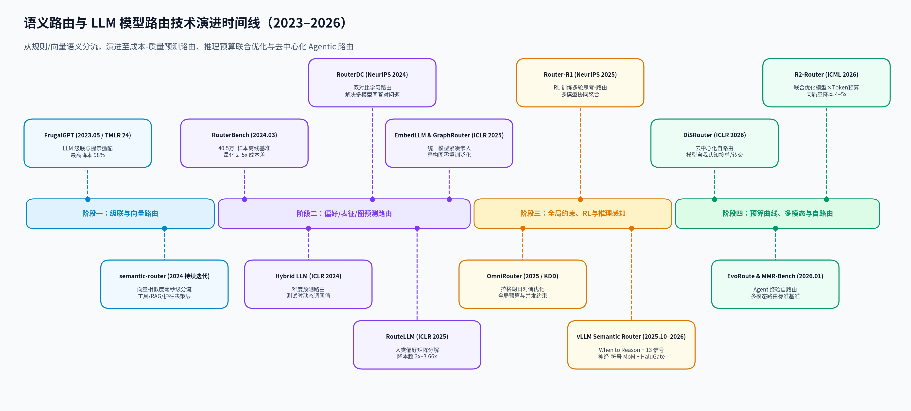
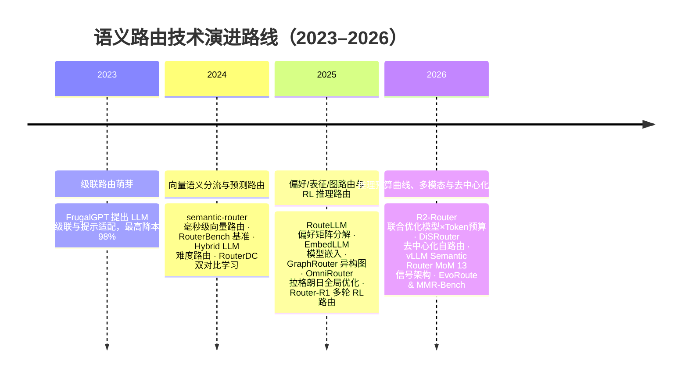
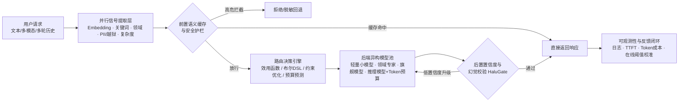

# 语义路由（Semantic Routing / LLM Routing）技术概括介绍

> 更新时间：2026 年 11 月  
> 本文系统拆解语义路由的核心定义、演进脉络、六大技术路线的底层算法原理与数学机制、生产级系统架构流水线、多维评估指标与基准、工程落地挑战、工业选型决策指南以及主流开源与商业生态。

## 1. 定义、定位与演进时间线

**语义路由（Semantic Routing）** 是一种基于输入请求语义表征与多维上下文信号（而非硬编码关键词或静态规则），将用户请求动态分发至最合适下游执行目标（不同尺寸/专长的 LLM、推理预算档位、工具/API、RAG 知识源或安全护栏）的智能控制层。

从工程与学术视角看，语义路由经历了三个递进层次：

| 演进层次 | 核心决策机制 | 典型延迟开销 | 解决的核心痛点 | 能力边界 | 典型代表 |
| :--- | :--- | :--- | :--- | :--- | :--- |
| **第一代：传统意图路由** | 正则表达式、关键词词典、传统 NLU 意图分类器 | < 1–5 ms | 确定性业务分流与固定 FAQ 命中 | 泛化能力弱，长尾意图维护成本极高 | 规则引擎、传统客服 NLU |
| **第二代：向量嵌入语义路由** | 稠密向量编码 + 原型相似度检索 + 校准阈值判断 | 5–20 ms | 绕过慢速 LLM 生成，毫秒级完成工具触发、RAG 分流与越狱拦截 | 对“语义相似但推理难度悬殊”的复杂查询区分度不足 | [Aurelio Labs `semantic-router`](https://github.com/aurelio-labs/semantic-router) |
| **第三代：LLM 模型与预算路由** | 难度/质量/成本联合预测、约束优化、神经-符号多信号编排或 RL 规划 | 10–50 ms（预测式）或百毫秒级（级联/RL） | 破解多模型集群中“质量—成本—延迟”帕累托权衡，动态控制推理强度 | 面临新模型冷启动、多轮 KV Cache 失效与对抗攻击挑战 | [RouteLLM](https://arxiv.org/abs/2406.18665) · [vLLM Semantic Router](https://arxiv.org/abs/2603.04444) · [R2-Router](https://arxiv.org/abs/2602.02823) |

2026 年两篇代表性综述 [Dynamic Model Routing and Cascading for Efficient LLM Inference (arXiv:2603.04445)](https://arxiv.org/abs/2603.04445) 与 [A Systematic Survey of Large Language Model Routing (Findings of EMNLP 2026)](https://aclanthology.org/2026.findings-emnlp.2072.pdf) 指出，现代 LLM 路由得以成立的根本基础在于**模型互补性（Model Complementarity）**：不同参数规模、后训练路线与专长的模型在任务域与难度层级上表现迥异，且单次调用成本相差 1–2 个数量级，使多模型集群得以演进为“系统级稀疏专家混合（System-level MoE）”。

## 2. 六大核心技术路线深度拆解

### 2.1 路线一：基于向量嵌入与相似度/聚类的语义路由
- **底层机制**：预先为每条路由 $r \in \mathcal{R}$ 准备若干代表性话术（Utterances），使用轻量级编码器将其映射为向量原型集合 $\{\mathbf{u}_{r,j}\}$ 或聚类中心 $\mathbf{c}_r$。在线阶段对查询 $q$ 编码得到 $\mathbf{e}_q$，计算最高相似度并经校准阈值 $\tau_r$ 判定：
  $$r^* = \arg\max_{r \in \mathcal{R}} \max_j \cos(\mathbf{e}_q, \mathbf{u}_{r,j}), \quad \text{若 } s(q, r^*) < \tau_{r^*} \text{ 则进入 Fallback 路由}$$
- **工程增强**：[Aurelio Labs `semantic-router`](https://github.com/aurelio-labs/semantic-router) 引入了基于验证集的自动阈值搜索（fit/calibration）、稀疏+稠密混合编码（Hybrid Encoder）以及概率置信度映射，避免手工拍脑袋设阈值。
- **适用场景**：意图分流、工具/Function Calling 预筛选、RAG 多库路由（SQL vs 文档库 vs 联网搜索）、合规/敏感话题快速拦截。

### 2.2 路线二：预测式路由（Predictive Routing）
在调用任何大语言模型生成内容**之前**，由轻量级路由模型一次性预测候选模型集合 $\mathcal{M}$ 在当前查询上的期望质量 $\hat{Q}(q, m)$ 与预期成本 $\hat{C}(q, m)$，单跳直达目标模型，实现最低端到端延迟。其内部衍生出四种核心建模范式：

1. **二元/多元难度分类与偏好矩阵分解**
   - [Hybrid LLM (ICLR 2024)](https://arxiv.org/abs/2404.14618) 训练轻量级编码器预测“小模型相对大模型的质量损失是否可接受”，测试时直接通过调节单标量阈值 $t$ 平滑滑动帕累托曲线，无需重训。
   - [RouteLLM (ICLR 2025)](https://arxiv.org/abs/2406.18665) 利用 Chatbot Arena 人类成对偏好数据，采用 **Bradley-Terry 矩阵分解（Matrix Factorization）** 学习查询投影 $\mathbf{v}_q$ 与模型隐向量 $\mathbf{v}_m$，预测强模型 $m_{\text{strong}}$ 击败弱模型 $m_{\text{weak}}$ 的胜率 $P(m_{\text{strong}} \succ m_{\text{weak}} \mid q) = \sigma(\mathbf{v}_q^\top (\mathbf{v}_{m_{\text{strong}}} - \mathbf{v}_{m_{\text{weak}}}))$。
2. **双对比学习与统一模型紧凑嵌入**
   - 传统单标签交叉熵分类无法表达“多个模型同时答对同一问题”的事实。[RouterDC (NeurIPS 2024)](https://arxiv.org/abs/2409.19886) 构建双对比损失：一方面在“查询—模型”空间拉近查询与所有胜出模型的嵌入、推远失败模型；另一方面在“查询—查询”空间聚类语义相近样本。
   - [EmbedLLM (ICLR 2025 Spotlight)](https://arxiv.org/abs/2410.02223) 通过编码器-解码器重构框架为数百个 LLM 学习低维**模型嵌入（Model Embeddings）**，使路由与基准得分预测退化为极轻量的线性映射。
3. **异构图神经网络路由（解决新模型冷启动）**
   - [GraphRouter (ICLR 2025)](https://arxiv.org/abs/2410.03834) 构建包含**任务节点、查询节点与 LLM 节点**的异构图，将路由转化为“查询—LLM”边属性（质量与成本）预测任务。新增未见模型时，只需向图中添加新节点并连接少量探针边即可零重训泛化。
4. **全局约束优化与推理预算联合预测**
   - [OmniRouter (2025)](https://arxiv.org/abs/2502.20576) 突破逐条贪心决策，引入**拉格朗日对偶分解（Lagrangian Dual Decomposition）**，在全局美元预算上限、质量底线与各后端异构并发容量限制下求解最优全局分配。
   - [R2-Router (ICML 2026)](https://arxiv.org/abs/2602.02823) 将模型表征从单点扩展为**质量-输出长度预算曲线**，联合优化 `(模型 m, Token 预算 b)` 二元组。

### 2.3 路线三：级联路由（Cascading）与混合管线
- **底层机制**：将候选模型按调用成本升序排列 $m_1 \prec m_2 \prec \dots \prec m_K$（如 [FrugalGPT](https://arxiv.org/abs/2305.05176)）。先由低成本模型 $m_1$ 生成草稿响应 $y_1$，再交由外部轻量化打分器 $g(q, y_1)$ 或模型自验证置信度判断：若 $g(q, y_1) \ge \theta_1$ 则直接返回，否则逐级升级（Escalate）至 $m_2, \dots, m_K$。
- **与预测式路由的核心权衡**：级联路由能观察真实生成文本，对“表面简单但小模型易产生幻觉”的样本纠错能力更强；但一旦触发升级，会产生**串行多跳延迟**与丢弃前序 Token 的额外成本（参见 [arXiv:2603.04445](https://arxiv.org/abs/2603.04445)）。
- **混合演进**：生产系统常采用“预测式初筛 + 后置低置信度/幻觉检测级联升级”两段式结构，兼顾首跳低延迟与兜底质量。

### 2.4 路线四：强化学习、在线 Bandit 与推理式多轮路由
- **在线上下文多臂老虎机（Contextual Bandit）**：将查询特征作为上下文 $x_t$、候选模型作为动作 $a_t$，依据在线隐式/显式反馈（如点赞、采纳率、裁判打分与真实 Token 账单）构造奖励 $r_t = Q_t - \lambda C_t$，在探索新模型与利用已知优解间动态自适应分布漂移。
- **多轮 RL 序列化路由**：[Router-R1 (NeurIPS 2025)](https://arxiv.org/abs/2506.09033) 直接使用强化学习训练具备推理能力的 LLM 担任路由器，交替执行内部思考（`think`）与外部异构模型调用（`route`），最后汇总多模型中间答案输出最终结果，适用于复杂多跳推理任务。

### 2.5 路线五：Agent 步骤级路由、去中心化自路由与知识源路由
- **Agent 轨迹步骤级路由**：长程 Agent 任务包含规划、代码编写、信息抽取、格式整理等差异巨大的子步骤，[EvoRoute (2026)](https://arxiv.org/abs/2601.02695) 基于历史执行经验为每一步动态选择最匹配的骨干模型。
- **去中心化自路由**：[DiSRouter (ICLR 2026)](https://arxiv.org/abs/2510.19208) 取消中心化小型外部路由器，通过两阶段自我认知训练（Self-Awareness Training）让每个 LLM 自主评估自身知识边界——能胜任则直接作答，超出能力则将请求转交网络中其他节点。
- **异构知识源路由**：在复杂 RAG 系统中，将子查询动态路由至向量数据库、SQL 引擎、知识图谱或外部工具 API（如 [DeepSieve (Findings of EACL 2026)](https://aclanthology.org/2026.findings-eacl.160.pdf)）。

### 2.6 路线六：信号驱动的神经-符号系统级策略路由
以 [vLLM Semantic Router (2026)](https://arxiv.org/abs/2603.04444) 与 [LiteLLM Auto Router v2](https://docs.litellm.ai/docs/proxy/auto_routing) 为代表，将路由控制平面下沉至云原生 AI 网关层：并行提取关键词/正则、语义嵌入、领域分类、PII/越狱风险、输入模态与推理需求等 **13 类异构信号**，经由可审计的布尔 DSL 规则编排决策树，再绑定语义缓存、幻觉拦截（HaluGate）与选模插件链执行。

## 3. 六大技术路线多维对比与选型决策矩阵

| 技术路线 | 典型代表 | 决策延迟 | 训练/维护成本 | 新模型零样本接入 | 复杂推理/多轮适配 | 核心优势 | 主要短板 | 最适用业务场景 |
| :--- | :--- | :--- | :--- | :--- | :--- | :--- | :--- | :--- |
| **向量相似度路由** | [semantic-router](https://github.com/aurelio-labs/semantic-router) | 极低（5–20 ms） | 极低（免训练，增删样本即生效） | 支持（按路由描述配置） | 弱 | 极速、可解释、易冷启动 | 无法精细区分同类文本的推理难度 | 工具触发、RAG 数据源分流、安全护栏 |
| **预测式分类/偏好路由** | [Hybrid LLM](https://arxiv.org/abs/2404.14618) · [RouteLLM](https://arxiv.org/abs/2406.18665) | 低（10–30 ms） | 中（需历史评测或人类偏好数据） | 弱–中（矩阵分解支持有限迁移） | 中 | 单跳低延迟、测试时可滑调成本阈值 | 模型池变动大时需重训或重校准 | 通用对话/QA 的强-弱模型成本优化 |
| **嵌入/图结构路由** | [EmbedLLM](https://arxiv.org/abs/2410.02223) · [GraphRouter](https://arxiv.org/abs/2410.03834) | 低（15–40 ms） | 中（需多模型跨任务评测矩阵） | **强**（少量探针样本即可接入） | 中 | 适合数十个以上大规模动态模型池 | 依赖初始跨模型交互矩阵质量 | 多供应商聚合平台、高频迭代模型池 |
| **级联路由** | [FrugalGPT](https://arxiv.org/abs/2305.05176) | 高（升级时多跳串行） | 中（需训练轻量质量打分器） | 强（按单价排序加入级联链） | 强（可校验实际输出） | 可基于真实响应兜底纠错，降本潜力大 | 尾延迟（P95/P99）劣化，打分器易成瓶颈 | 对延迟不敏感的离线批处理、高准确率审查 |
| **全局约束与预算曲线路由** | [OmniRouter](https://arxiv.org/abs/2502.20576) · [R2-Router](https://arxiv.org/abs/2602.02823) | 低–中（15–50 ms） | 中–高（需采集多预算/并发曲线） | 中 | **强**（原生适配推理模型） | 严守全局预算/SLA，消除过度思考浪费 | 前期性能曲线标定成本较高 | 推理模型服务、企业严格成本/配额管控 |
| **RL 多轮 / 去中心化 / 信号网关** | [Router-R1](https://arxiv.org/abs/2506.09033) · [DiSRouter](https://arxiv.org/abs/2510.19208) · [vLLM SR](https://arxiv.org/abs/2603.04444) | 中–高（视模式而定） | 高（RL 训练或系统网关部署） | 强（描述符驱动或自认知） | **极强** | 支持复杂多跳聚合、多模态与企业级合规 | 架构复杂度高，需完整可观测性闭环 | 复杂 Agent 系统、多模态统一推理网关 |

## 4. 生产级语义路由系统架构流水线

## 5. 核心评估指标与公开基准汇总

### 5.1 评估指标体系
- **系统效率指标**：路由额外延迟（Routing Overhead，工程通常要求 1–50 ms）、首字延迟（TTFT）、端到端吞吐与**成本节省率（Cost Reduction）**。
- **质量—成本帕累托指标**：
  - **CPT（Call-Performance Threshold）**：达到强模型目标性能比例（如 90%/95%）所需调用强模型的最低请求占比（[RouteLLM](https://arxiv.org/abs/2406.18665)）。
  - **PGR / APGR（Performance Gain Recovered）**：路由器相对弱模型恢复强-弱质量差距的比例及其跨成本阈值均值（[RouteLLM](https://arxiv.org/abs/2406.18665)）。
  - **AUC / nAUC / AUDC 与 QNC（Quality-Normalized Cost）**：综合衡量整条质量-成本曲线下的面积与单位质量成本（[MMR-Bench](https://arxiv.org/abs/2601.17814) · [R2-Router](https://arxiv.org/abs/2602.02823)）。
  - **Routing Optimality 与 Routing Robustness**：衡量路由器命中 Oracle 最优模型的比率，以及面对拼写错误、同义改写等输入噪声时的决策一致性（[RouterArena](https://arxiv.org/html/2510.00202v1)）。

### 5.2 主流公开基准清单

| 基准名称 | 年份 | 规模与覆盖范围 | 核心评测维度与定位 | 原始链接 |
| :--- | :--- | :--- | :--- | :--- |
| **RouterBench** | 2024 | 40.5 万+ 预计算推理结果，11 模型 × 8 数据集 | 首个多 LLM 路由离线评测基准，覆盖 MMLU、GSM8K、MBPP、MT-Bench 与 RAG | [arXiv:2403.12031](https://arxiv.org/abs/2403.12031) · [GitHub](https://github.com/withmartian/routerbench) |
| **RouterArena** | 2025 | 多学科、多难度开放式动态榜单 | 首个开放式 LLM 路由器综合对比平台，强调最优性与扰动鲁棒性 | [arXiv:2510.00202](https://arxiv.org/html/2510.00202v1) |
| **LLMRouterBench** | 2026 | 39.1 万+ 实例，21 数据集 × 33 模型 × 10 路由基线 | 纯性能与性能-成本双模式统一重测，揭示现有路由器与 Oracle 的召回差距 | [arXiv:2601.07206](https://arxiv.org/abs/2601.07206) |
| **MMR-Bench** | 2026 | 11,000 实例，10 MLLM × 8 视觉-语言数据集 | 面向多模态路由（OCR、VQA、多模态数学推理） | [arXiv:2601.17814](https://arxiv.org/abs/2601.17814) |
| **R2-Bench** | 2026 | 6 大基准 × 15 个 0.6B–235B 开源模型 | 首个系统记录不同输出长度预算下模型质量-成本曲线的数据集 | [arXiv:2602.02823](https://arxiv.org/abs/2602.02823) |

## 6. 工程落地四大核心挑战

1. **模型池高频迭代与冷启动**：基础模型几乎按月迭代，传统固定类别分类器需频繁重训；如何仅凭借少量探针样本或能力描述符实现零样本接入仍是关键难题（[EMNLP 2026 综述](https://aclanthology.org/2026.findings-emnlp.2072.pdf)）。
2. **离线基准红利与真实流量落差**：[LLMRouterBench (2026)](https://arxiv.org/abs/2601.07206) 统一重测表明，不少复杂路由方法在实际分布下难以稳定击败简单基线，主要瓶颈在于对专长模型的召回不足；[arXiv:2608.14641](https://arxiv.org/html/2608.14641v1) 亦强调评估必须设置“固定层级（Fixed-tier）”基线作为对照。
3. **多轮对话状态与 KV Cache 失效**：在多轮对话或长程 Agent 轨迹中频繁切换底层模型会破坏前缀 KV Cache 复用，反而推高 TTFT 与重复编码成本，需要引入会话粘性与前缀感知调度（[ARES](https://openreview.net/pdf?id=VbY7iyZuyN)）。
4. **路由器引入的新型安全攻击面**：攻击者可通过微小对抗扰动操纵路由分类边界，诱使高危请求绕过安全审查模型，或发动“成本放大攻击”将廉价流量全部导向昂贵旗舰模型（[EMNLP 2026 综述](https://aclanthology.org/2026.findings-emnlp.2072.pdf)）。

## 7. 主流开源框架与工业界生态全景

| 项目 / 平台 | 类型 | 核心技术机制与定位（截至 2026 年 11 月） | 官方链接 |
| :--- | :--- | :--- | :--- |
| **Aurelio Labs `semantic-router`** | 开源 Python 库（MIT） | 超低延迟语义决策层（已迭代至 v1.1.2），基于向量相似度或轻量模型毫秒级完成工具路由、RAG 分流与越狱护栏，支持概率校准与多模态 | [GitHub](https://github.com/aurelio-labs/semantic-router) · [官网](https://www.aurelio.ai/semantic-router) |
| **LMSYS RouteLLM** | 开源框架（Apache 2.0） | 源自 UC Berkeley / LMSYS 与 Anyscale，内置矩阵分解、相似度加权、BERT 与因果 LLM 四类强-弱路由器及阈值校准工具 | [GitHub](https://github.com/lm-sys/routellm) · [博客](https://www.lmsys.org/blog/2024-07-01-routellm/) |
| **vLLM Semantic Router** | 开源系统级路由（Apache 2.0） | vLLM 官方生态项目（2026 年发布 v0.4.0），Rust/Candle + Envoy ExtProc 架构，融合 13 类信号、布尔 DSL、13 种路由算法、HaluGate 幻觉检测与推理开关 | [GitHub](https://github.com/vllm-project/semantic-router) · [官网](https://vllm-sr.ai/) · [vLLM 博客](https://vllm.ai/blog/2025-09-11-semantic-router) |
| **Envoy AI Gateway** | 开源云原生 AI 网关 | 基于 Envoy（2026 年进入 1.0 阶段）将 LLM 路由下沉至 K8s 基础设施层，支持 OpenTelemetry 可观测性并原生集成 vLLM Semantic Router | [vLLM 集成文档](https://docs.vllm.ai/projects/production-stack/en/latest/use_cases/semantic-router-integration.html) · [教程](https://github.com/vllm-project/production-stack/blob/main/tutorials/24-semantic-router-integration.md) |
| **LiteLLM Router / Auto Router** | 开源代理与 SDK | 统一 LLM 网关，提供负载均衡、重试与冷却；Auto Router v2 已演进为融合语义关键词、启发式、LLM 与自定义分类器的混合路由 | [Routing 文档](https://docs.litellm.ai/docs/routing) · [Auto Router](https://docs.litellm.ai/docs/proxy/auto_routing) |
| **Martian** | 商业模型路由平台 | 模型路由先驱与 RouterBench 发起方，基于模型能力预测提供动态路由与企业合规网关 | [官网](https://withmartian.com/) · [文档](https://docs.withmartian.com/) |
| **Not Diamond** | 商业 API + 开源工具 | 预测式路由 API 与自定义路由器训练框架，并开源随机森林路由 [RoRF](https://github.com/Not-Diamond/RoRF) | [文档](https://docs.notdiamond.ai/docs/router-training-quickstart) · [Awesome 列表](https://github.com/Not-Diamond/awesome-ai-model-routing) |
| **OpenRouter Auto Router** | 商业网关内建路由 | 通过 `openrouter/auto` 自动选择模型与**推理强度（reasoning effort）**，2026 年升级为基于市场流量信号驱动的新版 Auto Router | [文档](https://openrouter.ai/docs/guides/routing/routers/auto-router) · [2026 公告](https://openrouter.ai/blog/announcements/introducing-the-new-auto-router/) |
| **Unify AI** | 商业路由与持续学习平台 | 支持按质量、延迟、吞吐与成本目标动态路由多供应商端点，并拓展至 AI 团队持续学习平台 | [官网](https://unify.ai/) · [GitHub](https://github.com/unifyai) |

在闭源云生态中，OpenAI GPT-5 已在模型服务内部集成动态路由以平衡能力与推理档位，Microsoft Azure AI Foundry 亦推出了托管式 Model Router 服务（参见 [R2-Router 综述](https://arxiv.org/abs/2602.02823)）。
