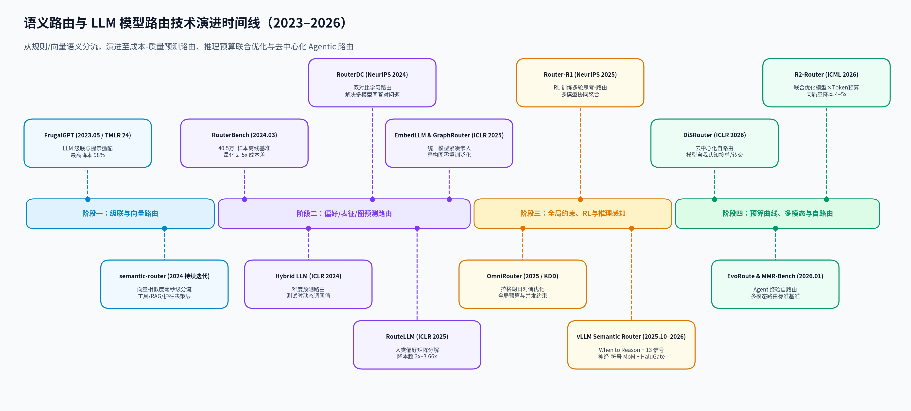
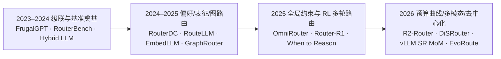

# 语义路由（Semantic Routing / LLM Routing）前沿论文与技术（2024–2026）

> 更新时间：2026 年 11 月  
> 本文精选 2023–2026 年间语义路由与 LLM 模型路由领域的 13 篇代表性前沿论文与 2 篇 2026 年权威综述，通过图像化演进时间线、多维技术对比总表与逐篇深度拆解，系统呈现该方向从“成本-质量单轮选模”迈向“推理预算联合优化、多模态与去中心化 Agentic 路由”的完整图景。

## 1. 2023–2026 前沿演进时间线

## 2. 代表性前沿论文多维对比总表

| 论文 / 系统 | 机构 / 主要作者 | 发表会议与年份 | 核心技术范式 | 新模型零样本接入 | 推理预算/多模态支持 | 代表性实验结论 | 原始链接 |
| :--- | :--- | :--- | :--- | :--- | :--- | :--- | :--- |
| **FrugalGPT** | Stanford（Lingjiao Chen, Matei Zaharia, James Zou） | TMLR 2024（arXiv 2023） | 提示适配 + 缓存 + LLM 级联 | 支持（按单价接入链条） | 否 | 同 GPT-4 性能最高降本 **98%**；同成本准确率 **+4%** | [arXiv:2305.05176](https://arxiv.org/abs/2305.05176) · [OpenReview](https://openreview.net/forum?id=cSimKw5p6R) |
| **Hybrid LLM** | Microsoft Research / UBC（Dujian Ding 等） | ICLR 2024 | 难度预测路由 + 测试时可调阈值 | 否（绑定大小模型对） | 否 | 不损质量下减少最高 **40%** 云端大模型调用 | [arXiv:2404.14618](https://arxiv.org/abs/2404.14618) · [OpenReview](https://openreview.net/forum?id=02f3mUtqnM) |
| **RouterBench** | Martian / UC Berkeley（Qitian Jason Hu 等） | arXiv 2024（ICML Workshop） | 40.5 万+ 样本标准化离线基准 | 评测基准 | 文本 + RAG | 量化同等性能下 LLM 成本常态相差 **2–5 倍** | [arXiv:2403.12031](https://arxiv.org/abs/2403.12031) · [GitHub](https://github.com/withmartian/routerbench) |
| **RouterDC** | 南科大 / 港科大（Shuhao Chen 等） | NeurIPS 2024 | 双对比学习（样本-LLM & 样本-样本） | 否（需重训模型嵌入） | 否 | 较最强单体/基线 **+2.76%（ID）**、**+1.90%（OOD）** | [arXiv:2409.19886](https://arxiv.org/abs/2409.19886) · [GitHub](https://github.com/shuhao02/RouterDC) |
| **RouteLLM** | UC Berkeley / LMSYS / Anyscale（Isaac Ong 等） | ICLR 2025 | 人类偏好数据矩阵分解 / 分类器 | 支持（强-弱模型对迁移） | 否 | 降本超 **2x**（MT-Bench 95% 质量下最高 **3.66x**） | [arXiv:2406.18665](https://arxiv.org/abs/2406.18665) · [GitHub](https://github.com/lm-sys/routellm) |
| **EmbedLLM** | UC Berkeley（Richard Zhuang 等） | ICLR 2025 Spotlight | 编码器-解码器重构学习统一模型嵌入 | 中（少量评测即可投影） | 否 | 线性层即胜既有路由，自动捕获代码等隐含专长 | [arXiv:2410.02223](https://arxiv.org/abs/2410.02223) · [GitHub](https://github.com/richardzhuang0412/EmbedLLM) |
| **GraphRouter** | UIUC（Tao Feng, Yanzhen Shen, Jiaxuan You） | ICLR 2025 | “任务-查询-LLM”异构图边预测 | **强**（无需重训泛化） | 否 | 较基线至少 **+12.3%**；未见新模型泛化至少 **+9.5%** | [arXiv:2410.03834](https://arxiv.org/abs/2410.03834) · [GitHub](https://github.com/ulab-uiuc/GraphRouter) |
| **OmniRouter** | Kai Mei, Yongfeng Zhang 等 | arXiv 2025（KDD 相关） | 检索增强预测 + 拉格朗日对偶全局优化 | 中 | 全局并发与预算约束 | 严守全局约束下准确率 **+6.30%**、成本降 **≥10.15%** | [arXiv:2502.20576](https://arxiv.org/abs/2502.20576) · [KDD PDF](https://kdd.org/exploration_files/p107_Omnirouter_camera_ready.pdf) |
| **Router-R1** | UIUC（Haozhen Zhang, Tao Feng, Jiaxuan You） | NeurIPS 2025 | RL 训练 LLM 多轮“思考-路由-聚合” | **强**（依赖文本描述符） | 多跳协同聚合 | 在 7 个通用与多跳 QA 基准全面超越强基线 | [arXiv:2506.09033](https://arxiv.org/abs/2506.09033) |
| **vLLM Semantic Router** | vLLM 团队 / Red Hat（Chen Wang 等） | NeurIPS 2025 Workshop & 2026 | 推理开关 + 13 信号神经-符号 MoM + HaluGate | 强（声明式策略配置） | **推理模式 + 多模态** | MMLU-Pro **+10.2 pp**、延迟 **-47.1%**、Token **-48.5%** | [arXiv:2510.08731](https://arxiv.org/abs/2510.08731) · [arXiv:2603.04444](https://arxiv.org/abs/2603.04444) |
| **DiSRouter** | Hang Zheng, Lu Chen, Kai Yu 等 | ICLR 2026 | 去中心化自路由 + 两阶段自我认知训练 | **强**（节点自治扩展） | OOD 强泛化 | 多场景效用显著领先中心化路由，OOD 鲁棒性突出 | [arXiv:2510.19208](https://arxiv.org/abs/2510.19208) |
| **R2-Router** | UCF 等（Jiaqi Xue, Qian Lou 等） | ICML 2026 | 预测“模型 × 输出长度预算”质量-成本曲线 | 中（可与 UniRouter 结合） | **原生推理 Token 预算** | 同质量降本 **4–5x**，录用时登顶 RouterArena 榜首 | [arXiv:2602.02823](https://arxiv.org/abs/2602.02823) · [OpenReview](https://openreview.net/pdf?id=S3m1tSp8F4) |
| **EvoRoute** | Guibin Zhang, Shuicheng Yan 等 | arXiv 2026 | 多步 Agent 系统的经验驱动自路由 | 强 | Agent 长程轨迹 | 动态适配多步子任务复杂度，显著降低 Agent 轨迹成本 | [arXiv:2601.02695](https://arxiv.org/abs/2601.02695) |

## 3. 重点论文深度解析

### 3.1 奠基工作与单轮成本-质量路由（2023–2025）

#### 1. FrugalGPT（TMLR 2024）
- **英文原标题**：*FrugalGPT: How to Use Large Language Models While Reducing Cost and Improving Performance*
- **核心架构与创新**：提出降低 LLM 推理费用的三大范式——提示词适配（减少冗余上下文）、LLM 近似（语义缓存与小模型微调）及 **LLM 级联（LLM Cascade）**。离线阶段在验证集上搜索最优模型排序与打分阈值；在线阶段从廉价模型起逐级生成并经轻量打分器验收，不达标才升级。
- **关键结论与局限**：在保持与 GPT-4 同等性能的前提下最高降低 **98%** 成本，同等预算下准确率提升 **4%**；局限在于级联升级会引入显著尾延迟，且高度依赖打分器自身的可靠性（[arXiv:2305.05176](https://arxiv.org/abs/2305.05176)）。

#### 2. Hybrid LLM（ICLR 2024）
- **英文原标题**：*Hybrid LLM: Cost-Efficient and Quality-Aware Query Routing*
- **核心架构与创新**：面向云-边/大小模型混合架构，训练轻量级 DeBERTa 路由器预测查询在弱模型上的预期质量差距，创新性地支持**测试时无重训动态调节权衡阈值**，灵活适配不同业务 SLA。
- **关键结论与局限**：在不损失响应质量前提下最多减少 **40%** 云端大模型调用；局限在于主要面向二元强-弱模型对，扩展至多模型池需重构输出头（[arXiv:2404.14618](https://arxiv.org/abs/2404.14618)）。

#### 3. RouterBench（2024）
- **英文原标题**：*RouterBench: A Benchmark for Multi-LLM Routing System*
- **核心贡献**：发布超过 **40.5 万条**预计算推理结果的标准化离线基准（11 个开源与闭源模型 × 8 个任务数据集），并定义严格的理论评估框架，量化了同性能水平下不同 LLM 服务常态存在 **2–5 倍** 成本差异（[arXiv:2403.12031](https://arxiv.org/abs/2403.12031)）。

#### 4. RouterDC（NeurIPS 2024）
- **英文原标题**：*RouterDC: Query-Based Router by Dual Contrastive Learning for Assembling Large Language Models*
- **核心架构与创新**：针对多模型常常同时答对同一查询导致单标签交叉熵失效的问题，采用查询编码器与可学习 LLM 嵌入，构建**双对比损失**：样本-LLM 对比损失拉近查询与所有胜出模型、推远失败模型；样本-样本对比损失聚合语义相近样本。
- **关键结论**：在分布内（ID）与分布外（OOD）任务上分别取得 **+2.76%** 与 **+1.90%** 的显著性能提升（[arXiv:2409.19886](https://arxiv.org/abs/2409.19886)）。

#### 5. RouteLLM（ICLR 2025）
- **英文原标题**：*RouteLLM: Learning to Route LLMs with Preference Data*
- **核心架构与创新**：系统利用 Chatbot Arena 人类偏好数据与合成增强数据训练强-弱路由器，横向对比相似度加权排序、矩阵分解（MF）、BERT 分类器与因果 LLM 分类器四类方案，并提出 CPT、PGR、APGR 标准化评测指标。
- **关键结论**：在 MT-Bench、MMLU、GSM8K 上实现超 **2 倍** 成本节省（MT-Bench 达到 95% GPT-4 性能时降本 **3.66 倍**），且可迁移至训练未见过的强-弱模型对（[arXiv:2406.18665](https://arxiv.org/abs/2406.18665)）。

#### 6. EmbedLLM（ICLR 2025 Spotlight）
- **英文原标题**：*EmbedLLM: Learning Compact Representations of Large Language Models*
- **核心架构与创新**：通过编码器-解码器重构框架为数百个 LLM 学习统一、低维的**紧凑向量表征（Model Embeddings）**，使下游路由、未知题目正确率预测与基准成绩推断仅需一层线性映射即可完成。
- **关键结论**：在路由准确率与低延迟上均优于既有基线，且无监督探针证实模型嵌入自动编码了代码专长等模型能力维度（[arXiv:2410.02223](https://arxiv.org/abs/2410.02223)）。

#### 7. GraphRouter（ICLR 2025）
- **英文原标题**：*GraphRouter: A Graph-based Router for LLM Selections*
- **核心架构与创新**：构建包含**任务节点、查询节点与 LLM 节点**的异构图，以图神经网络执行边属性（响应质量与成本）预测，天然捕获“任务-查询-模型”高阶交互，并在引入新 LLM 时通过少量交互边实现**零重训泛化**。
- **关键结论**：在三种性能-成本权重配置下至少领先基线 **12.3%**，在新模型泛化场景下至少提升 **9.5%**（[arXiv:2410.03834](https://arxiv.org/abs/2410.03834)）。

#### 8. OmniRouter（2025）
- **英文原标题**：*OmniRouter: Budget and Performance Controllable Multi-LLM Routing*
- **核心架构与创新**：将多 LLM 路由从局部贪心提升为**全局约束优化**：第一阶段用混合检索增强预测器估计能力与成本，第二阶段通过带自适应乘子的拉格朗日对偶分解，在全局预算上限、质量底线与各后端异构并发配额下求得最优流量分配。
- **关键结论**：在严格运维约束下相比强路由基线准确率最高提升 **6.30%**，同时至少降低 **10.15%** 计算成本（[arXiv:2502.20576](https://arxiv.org/abs/2502.20576)）。

---

### 3.2 推理感知、强化学习、去中心化与系统级前沿（2025–2026）

#### 9. Router-R1（NeurIPS 2025）
- **英文原标题**：*Router-R1: Teaching LLMs Multi-Round Routing and Aggregation via Reinforcement Learning*
- **核心架构与创新**：将路由与多模型结果聚合建模为序列化强化学习决策过程。路由器本身由具备推理能力的 LLM 担任，在“格式奖励 + 结果准确率奖励 + 成本惩罚”联合优化下，学会多轮交替执行内部思考（`think`）与外部模型调用（`route`），且仅凭价格、延迟与示例性能描述符即可泛化至未见模型。
- **关键结论**：在 7 个通用与多跳 QA 基准上全面超越强基线（[arXiv:2506.09033](https://arxiv.org/abs/2506.09033)）。

#### 10. vLLM Semantic Router（2025–2026）
- **英文原标题**：*When to Reason: Semantic Router for vLLM*（NeurIPS 2025 Workshop）与 *vLLM Semantic Router: Signal Driven Decision Routing for Mixture-of-Modality Models*（2026 系统报告）
- **核心架构与创新**：2025 年聚焦判断查询“何时需要开启链式推理”，拦截简单请求的过度思考；2026 年演进为面向混合模态（MoM）的 **Signal-Decision-Plugin 三层架构**，融合 13 类亚毫秒启发式与神经信号、强类型布尔 DSL 编排、13 种选模算法、三阶段幻觉检测管线 **HaluGate** 及情景记忆系统。
- **关键结论**：在 MMLU-Pro 上相对直接 vLLM 推理实现 **+10.2 个百分点** 准确率提升，同时降低 **47.1%** 响应延迟与 **48.5%** Token 消耗（[arXiv:2510.08731](https://arxiv.org/abs/2510.08731) · [arXiv:2603.04444](https://arxiv.org/abs/2603.04444)）。

#### 11. DiSRouter（ICLR 2026）
- **英文原标题**：*DiSRouter: Distributed Self-Routing for LLM Selections*
- **核心架构与创新**：打破“中心化小路由器替大模型做决策”的固有框架，提出**去中心化自路由**：查询在 LLM 网络中流转，各模型经两阶段自我认知训练（Self-Awareness Training）独立判断自身能力边界，胜任则作答、否则转交其他节点，在 OOD 泛化与系统横向扩展性上优势显著（[arXiv:2510.19208](https://arxiv.org/abs/2510.19208)）。

#### 12. R2-Router（ICML 2026）
- **英文原标题**：*R2-Router: A New Paradigm for LLM Routing with Reasoning*
- **核心架构与创新**：突破传统“每模型单点（质量，成本）”抽象，将**输出/思考长度预算**引入决策空间，为每个模型预测完整**质量-成本曲线**并联合优化 `(模型, Token 预算)` 对，同步构建 **R2-Bench** 数据集。
- **关键结论**：证明“强模型 + 受限输出预算”在同等成本下常优于弱模型；同质量下较现有路由器降本 **4–5 倍**，录用时位居 [RouterArena](https://arxiv.org/html/2510.00202v1) 榜首；与动态池路由器结合后同质量成本可降 80%（[arXiv:2602.02823](https://arxiv.org/abs/2602.02823)）。

#### 13. 2026 年权威综述参考
- [Dynamic Model Routing and Cascading for Efficient LLM Inference (arXiv:2603.04445)](https://arxiv.org/abs/2603.04445)：系统统一预测式路由、级联路由与混合管线的理论与工程权衡。
- [A Systematic Survey of Large Language Model Routing (Findings of EMNLP 2026)](https://aclanthology.org/2026.findings-emnlp.2072.pdf)：全景梳理静态/动态路由、模型池泛化、安全攻击面与开放问题。

## 4. 2025–2026 年新兴技术趋势

1. **从一维“选模型”迈向二维“模型 × 推理预算”联合决策**：随着深度推理模型普及，[R2-Router](https://arxiv.org/abs/2602.02823)、[vLLM Semantic Router](https://arxiv.org/abs/2510.08731) 与 [OpenRouter Auto Router](https://openrouter.ai/docs/guides/routing/routers/auto-router) 均将“是否开启 CoT / 推理档位 / Token 预算”纳入统一路由，根治简单查询的过度思考浪费。
2. **多模态与混合模态（MoM）统一路由**：从纯文本扩展至图文/音视频 MLLM 与专用小模型协同，评测以 [MMR-Bench (2026)](https://arxiv.org/abs/2601.17814) 为标杆，系统以 [vLLM Semantic Router MoM](https://arxiv.org/abs/2603.04444) 为代表。
3. **Agentic 多轮规划与去中心化自路由**：路由器从被动单跳分类器升级为具备多轮思考与聚合能力的 RL 智能体（[Router-R1](https://arxiv.org/abs/2506.09033) · [EvoRoute](https://arxiv.org/abs/2601.02695)）或由模型自知边界驱动的分布式网络（[DiSRouter](https://arxiv.org/abs/2510.19208)）。
4. **控制平面与推理基础设施深度融合**：语义路由正下沉至云原生网关（Envoy AI Gateway + vLLM Semantic Router），将意图分发、语义缓存、PII/越狱护栏、幻觉拦截（HaluGate）与多轮 KV Cache 亲和调度（[ARES](https://openreview.net/pdf?id=VbY7iyZuyN)）统一编排。
