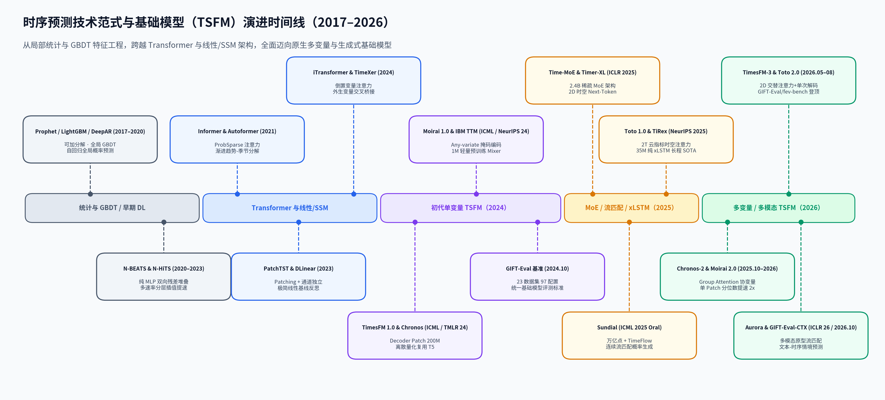
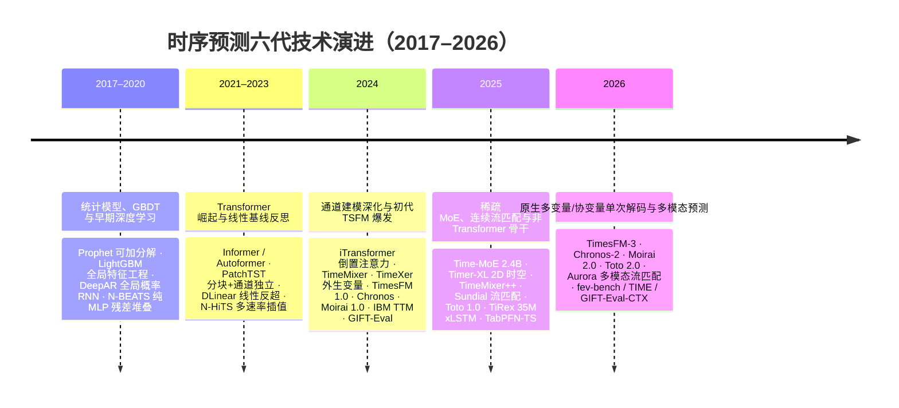

# 时序预测（Time Series Forecasting）技术概括介绍

> 更新时间：2026 年 11 月  
> 本文系统梳理时序预测的任务分类、六代技术演进的底层算法原理与数学机制、核心共性模块（非平稳归一化、分解、通道策略与概率头）、多维路线对比与选型矩阵、主流公开基准及核心评估指标。

## 1. 问题定义与五维任务分类

**时序预测（Time Series Forecasting, TSF）** 旨在基于按时间顺序采样的历史观测序列 $\mathbf{X}_{1:L} \in \mathbb{R}^{L \times C}$，推断未来预测窗口（Horizon）内的目标序列 $\mathbf{Y}_{L+1:L+H}$。根据数据结构与业务约束，主要划分为五个维度：

| 分类维度 | 子类型对比 | 核心建模难点 | 典型应用场景 |
| :--- | :--- | :--- | :--- |
| **变量维度** | 单变量（Univariate） vs. 多变量（Multivariate） | 平衡单序列自相关与跨通道滞后因果关系，防止多变量噪声引发过拟合 | 单品销量 vs. 区域电网多节点负荷 |
| **输出形式** | 点预测（Point） vs. 概率预测（Probabilistic） | 在偏态、厚尾与多峰分布下同时保持分布校准度与区间锐度（[DeepAR](https://arxiv.org/abs/1704.04110)） | 均值排产 vs. 安全库存、尾部风险控制 |
| **时间跨度** | 短期预测 vs. 长期预测（LTSF，$H \ge 96 \sim 720$） | 长程自回归误差累积、非平稳趋势漂移与长序列计算复杂度（[Informer](https://arxiv.org/abs/2012.07436)） | 未来数小时负荷 vs. 未来数周气象/流量 |
| **外部信息** | 纯内生变量 vs. 含协变量（静态 / 历史可见 / 未来已知） | 异构特征融合与未来已知信息前瞻对齐（[TimeXer](https://arxiv.org/abs/2402.19072) · [TimesFM-3](https://research.google/blog/timesfm-3-a-zero-shot-foundation-model-for-multivariate-forecasting/)） | 纯历史曲线外推 vs. 促销/节假日/天气驱动预测 |
| **学习范式** | 单数据集全监督训练 vs. 跨领域零样本/少样本基础模型 | 跨频率、跨量纲与未知领域的分布外泛化（[TimesFM](https://arxiv.org/abs/2310.10688) · [TTM](https://arxiv.org/abs/2401.03955)） | 定制专有模型 vs. 新上线商品/监控指标冷启动 |

## 2. 技术演进时间线

## 3. 六大技术路线底层原理深度拆解

### 3.1 第一代：传统统计模型（局部单序列建模）
- **ARIMA / SARIMA**：通过 $d$ 阶差分消除非平稳趋势，再以自回归项（AR，$p$ 阶历史值线性组合）和移动平均项（MA，$q$ 阶历史残差组合）刻画平稳动态。
- **指数平滑（ETS / Holt-Winters）**：显式维护水平（Level）、趋势（Trend）与季节（Seasonality）三个状态方程，按指数衰减权重滚动更新，结构透明且参数极少。
- **[Prophet (Taylor & Letham, 2017/2018)](https://www.researchgate.net/publication/344989540_Forecasting_at_scale)**：将时序建模为可加广义模型 $y(t) = g(t) + s(t) + h(t) + \epsilon_t$（分段线性/逻辑斯蒂趋势 + 傅里叶级数周期 + 节假日指示函数），对缺失值与突变点鲁棒。
- **核心局限**：属于**局部模型（Local Models）**，每条序列独立拟合，无法跨数万条相关序列共享模式，难以利用高维非线性协变量。

### 3.2 第二代：传统机器学习（GBDT 全局表格化范式）
- **核心机制**：以 [LightGBM](https://arxiv.org/pdf/2203.06848)、XGBoost、CatBoost 为代表，通过手工构造**滞后特征（Lag）**、**多窗口滑动统计量（Rolling Mean/Std）**、**日历周期特征**与静态类别特征，将时序预测转化为标准表格监督回归，并在全量序列上训练单一**全局模型（Global Model）**。
- **多步策略**：采用递归单步预测（Recursive，易累积误差）或为每个未来步长训练独立模型（Direct）。在 M5 零售预测竞赛中前 50 名全部采用 LightGBM（[INFORMS Demand Forecasting Study](https://pubsonline.informs.org/doi/10.1287/inte.2024.0126)）。
- **核心局限**：树模型天然缺乏线性外推能力（对超出训练集极值的新高趋势预测会截断），且强依赖领域特征工程。

### 3.3 第三代：早期深度学习（RNN / TCN / 纯 MLP 残差）
- **[DeepAR (Salinas et al., 2017/2020)](https://arxiv.org/abs/1704.04110)**：采用自回归 RNN（LSTM/GRU）在每个时间步输出条件分布参数（如高斯均值/方差或负二项分布），训练期最大化对数似然，推理期经蒙特卡洛采样生成未来轨迹，确立深度全局概率预测范式。
- **[N-BEATS (ICLR 2020)](https://arxiv.org/abs/1905.10437) 与 [N-HiTS (AAAI 2023)](https://arxiv.org/html/2201.12886v6)**：N-BEATS 摒弃循环结构，用纯全连接块堆叠“回溯残差消除（Backcast）+ 前向叠加（Forecast）”，并可选用多项式与傅里叶基函数提供可解释分解；N-HiTS 引入**多速率分层采样（Multi-rate Signal Sampling）与分层插值**，不同层级专注不同频段，大幅降低长程预测计算量与误差。

### 3.4 第四代：Transformer 时代（从点级注意力到 Patch 与变量级反转）
- **早期稀疏注意力与分解**：[Informer (AAAI 2021)](https://arxiv.org/abs/2012.07436) 提出 $O(L \log L)$ ProbSparse 注意力与一次生成式解码；[Autoformer (NeurIPS 2021)](https://arxiv.org/html/2106.13008v5) 将移动平均趋势-季节分解嵌入网络内部，以基于 FFT 的自相关机制替代点积注意力。
- **[PatchTST (ICLR 2023)](https://arxiv.org/abs/2211.14730)（确立现代标准范式）**：提出两大关键原则——① **子序列分块（Patching）**：将相邻 $P$ 个时间步聚合为一个 Patch Token，既保留局部语义又将序列长度压缩至 $L/P$、注意力复杂度下降 $P^2$ 倍；② **通道独立（Channel-Independence, CI）**：多变量序列各通道共享同一套 Transformer 权重独立预测，大幅抑制跨通道噪声过拟合。
- **[iTransformer (ICLR 2024 Spotlight)](https://arxiv.org/html/2310.06625v4) 与 [TimeXer (NeurIPS 2024)](https://arxiv.org/abs/2402.19072)**：iTransformer 倒置维度——把**整条变量序列**编码为单个 Token，用自注意力显式捕捉跨变量相关性、用前馈网络提取时间表征；TimeXer 则在内生变量 Patch 自注意力与外生变量交叉注意力间引入“全局内生 Token”桥接，专门攻克含外生变量预测。

### 3.5 第五代：线性、全 MLP 与状态空间模型（SSM / xLSTM）
- **[DLinear (AAAI 2023)](https://arxiv.org/abs/2205.13504)**：指出自注意力的置换不变性会损失时序顺序信息，仅用“移动平均趋势-季节分解 + 两个单层线性投影”便在多个长序列基准上反超早期复杂 Transformer，引发全领域对归纳偏置的深刻反思。
- **[TimeMixer (ICLR 2024)](https://arxiv.org/abs/2405.14616) 与 [TimeMixer++ (ICLR 2025 Oral)](https://arxiv.org/abs/2410.16032)**：利用多尺度下采样在微观与宏观尺度间执行“自底向上季节混合 + 自顶向下趋势混合”（PDM/FMM）；TimeMixer++ 进一步将多周期序列重构为 2D 多分辨率时间图像。
- **状态空间模型与现代循环架构**：[S-Mamba (2024)](https://arxiv.org/abs/2403.11144) 利用选择性状态空间（Mamba）实现线性复杂度长程建模；[TiRex (NeurIPS 2025)](https://arxiv.org/abs/2505.23719) 采用纯 **xLSTM（sLSTM 块）** 以仅 35M 参数实现极强长程零样本预测，证明非 Transformer 序列架构的强大生命力。

### 3.6 第六代：时序基础模型（TSFMs）的四大预训练范式
2024–2026 年，时序基础模型通过在百亿至万亿级真实与合成时间点上预训练，实现跨领域零样本推理，演化出四条核心建模路线：
1. **离散量化 + 语言模型复用**：将连续数值缩放分桶为离散词表，直接以交叉熵训练 T5 等语言模型（如初代 [Chronos](https://arxiv.org/abs/2403.07815)），缺点是量化带来精度损失且自回归采样偏慢。
2. **连续 Patch 回归 / 非参数分位数单次解码**：直接对连续 Patch 编码，结合连续 Patch 掩码（CPM）与 Pinball Loss 一次前向输出多步分位点（如 [TimesFM-3](https://research.google/blog/timesfm-3-a-zero-shot-foundation-model-for-multivariate-forecasting/) · [Chronos-2](https://arxiv.org/abs/2510.15821) · [Moirai 2.0](https://arxiv.org/abs/2511.11698)），已成为 2026 年工业界最主流路线。
3. **连续空间流匹配（Flow Matching）生成式建模**：直接在连续值域学习下一 Patch 条件分布的速度场，无需离散量化且支持毫秒级多峰概率采样（如 [Sundial](https://arxiv.org/abs/2502.00816) · [Aurora](https://arxiv.org/abs/2509.22295)）。
4. **合成先验 + 上下文学习（ICL / PFN）**：在纯合成动力学或高斯过程先验上预训练表格/时序先验拟合网络，推理时以单次前向完成上下文概率推断（如 [TabPFN-TS](https://arxiv.org/abs/2501.02945) · [Toto 2.0](https://arxiv.org/html/2605.20119v2)）。

## 4. 核心共性组件与技术挑战解法

1. **非平稳性与分布漂移 → 可逆实例归一化（RevIN）**：[RevIN (ICLR 2022)](https://openreview.net/forum?id=cGDAkQo1C0p) 在输入端对每条历史窗口独立计算均值 $\mu_x$ 与标准差 $\sigma_x$ 做归一化，在输出端用同一组统计量反归一化恢复量纲，几乎成为所有现代深度模型与 TSFM 的标配组件。
2. **通道独立（CI） vs. 通道相关（CD）的折中**：纯 CI（PatchTST）泛化稳健但忽略协变量；纯 CD（早期多变量 Transformer）易过拟合。2025–2026 年前沿方案转向**结构化交替/分组注意力**——例如 [TimesFM-3](https://research.google/blog/timesfm-3-a-zero-shot-foundation-model-for-multivariate-forecasting/) 的 2D 交替时间-变量注意力与 [Chronos-2](https://arxiv.org/abs/2510.15821) 的 Group Attention，在保留 CI 稳健性的同时按需开启跨变量交互。
3. **自回归误差累积 → 连续掩码单次非自回归解码**：通过将整个预测窗口置为掩码 Patch 一次性并行解码（[TimesFM-3](https://research.google/blog/timesfm-3-a-zero-shot-foundation-model-for-multivariate-forecasting/) · [TiRex](https://arxiv.org/abs/2505.23719)），显著抑制长预测步长下的误差滚雪球与分位数坍塌。

## 5. 六大技术路线多维对比与工业选型指南

| 技术路线 | 代表模型 | 样本量需求 | 外生协变量支持 | 概率不确定性 | 计算/推理成本 | 核心优势 | 主要短板 | 推荐业务场景 |
| :--- | :--- | :--- | :--- | :--- | :--- | :--- | :--- | :--- |
| **统计模型** | ARIMA · ETS · [Prophet](https://www.researchgate.net/publication/344989540_Forecasting_at_scale) | 极低（单条数十点即可） | 弱–中（Prophet 较好） | 原生置信区间 | 极低（CPU 毫秒级） | 可解释极强、无需 GPU、冷启动快 | 无法跨序列共享模式、非线性弱 | 低频财务/宏观指标、强可解释性汇报 |
| **GBDT 表格化** | [LightGBM](https://arxiv.org/pdf/2203.06848) · XGBoost | 中–高 | **极强**（任意静态/动态特征） | 分位数回归目标 | 低–中（CPU 高效） | 业务特征融合天花板、工程最成熟 | 缺乏趋势外推能力、特征工程重 | 零售销量、供应链补货（强促销/节假日） |
| **专用深度模型** | [PatchTST](https://arxiv.org/abs/2211.14730) · [iTransformer](https://arxiv.org/html/2310.06625v4) · [TimeXer](https://arxiv.org/abs/2402.19072) | 中–高（需域内训练） | 强（TimeXer 专用） | 需搭配分位/概率头 | 中（需按场景重训） | 特定固定领域充分微调后精度极高 | 跨领域零样本能力弱、维护成本高 | 长期固定业务（电网、气象、交通专网） |
| **线性 / MLP / SSM** | [DLinear](https://arxiv.org/abs/2205.13504) · [TimeMixer++](https://arxiv.org/abs/2410.16032) · [TiRex](https://arxiv.org/abs/2505.23719) | 低–中 | 中 | 支持分位头 | **低**（极高吞吐） | 性价比极高、长序列显存友好 | 复杂跨模态交互弱于大模型 | 高并发实时推理、边缘设备与资源受限场景 |
| **通用基础模型（TSFM）** | [TimesFM-3](https://research.google/blog/timesfm-3-a-zero-shot-foundation-model-for-multivariate-forecasting/) · [Chronos-2](https://arxiv.org/abs/2510.15821) · [Moirai 2.0](https://arxiv.org/abs/2511.11698) · [Sundial](https://arxiv.org/abs/2502.00816) | **极低（支持零样本）** | **强**（2026 新一代原生支持） | **原生分位数或流匹配采样** | 中（单卡可批量秒级推理） | 开箱即用、免特征工程、跨领域泛化强 | 极端专有业务规则仍需少样本微调 | 多品类冷启动、云监控 AIOps、统一预测中台 |

## 6. 主流公开基准与评估指标

### 6.1 公开基准演进清单

| 基准名称 | 年份 / 机构 | 规模与特点 | 解决的核心评测痛点 | 原始链接 |
| :--- | :--- | :--- | :--- | :--- |
| **传统 LSTF（ETT / Weather / ECL / Traffic）** | 2021 起 | 固定窗口长序列（$H \in \{96,192,336,720\}$） | 推动 Transformer 与线性模型早期迭代，但数据集偏小且易饱和 | [Informer](https://arxiv.org/abs/2012.07436) · [iTransformer](https://arxiv.org/html/2310.06625v4) |
| **M4 & Monash Archive** | 2018 / NeurIPS 2021 | M4 含 10 万条 6 频率序列；Monash 含 50 个跨 9 领域子集 | 确立跨频率、跨领域标准单变量评测 | [Monash Archive](https://arxiv.org/pdf/2105.06643) |
| **GIFT-Eval** | 2024（Salesforce） | 23 数据集、14.4 万+ 序列、1.77 亿观测点、97 配置 + 无泄露预训练集 | 首个大规模防泄露 TSFM 统一评测基准 | [arXiv:2410.10393](https://arxiv.org/html/2410.10393v2) · [GitHub](https://github.com/SalesforceAIResearch/gift-eval) |
| **fev-bench** | 2025/2026（Amazon AWS） | 100 项真实任务（68 项含多变量/协变量/缺失值/混合特征） | 弥补单变量基准脱离真实业务协变量的短板 | [arXiv:2509.26468](https://arxiv.org/pdf/2509.26468) · [GitHub](https://github.com/autogluon/fev) |
| **BOOM** | NeurIPS 2025（Datadog） | 2,807 条云原生观测指标、3.5 亿时间点（高频、长尾、突发尖峰） | 填补云运维/可观测性领域大规模基准空白 | [arXiv:2505.14766](https://arxiv.org/abs/2505.14766) |
| **TIME** | 2026 | 50 个 2024–2025 新采集数据集与 98 项任务 | 严格时间切分，防止基础模型预训练数据泄露 | [arXiv:2602.12147](https://arxiv.org/html/2602.12147v4) |
| **GIFT-Eval-CTX** | 2026.10（Salesforce） | 融合文本上下文与数值时序的开源基准 | 开创多模态情境预测（Contextual Forecasting）统一评测 | [arXiv:2610.17794](https://arxiv.org/html/2610.17794v1) · [博客](https://www.salesforce.com/blog/gift-eval-ctx/) |

### 6.2 核心评估指标公式与适用场景

| 指标 | 类型 | 数学定义 / 原理 | 尺度无关 | 核心特性与主流应用 |
| :--- | :--- | :--- | :--- | :--- |
| **MSE** | 点预测 | $\frac{1}{H}\sum_{t=1}^H (y_t - \hat{y}_t)^2$ | 否 | 对大误差与尖峰惩罚重；传统 LSTF 基准常用 |
| **MAE** | 点预测 | $\frac{1}{H}\sum_{t=1}^H \|y_t - \hat{y}_t\|$ | 否 | 对离群点稳健，对应预测分布中位数最优 |
| **sMAPE** | 点预测 | $\frac{200\%}{H}\sum_{t=1}^H \frac{\|y_t - \hat{y}_t\|}{\|y_t\| + \|\hat{y}_t\|}$ | 是 | 避免真值趋零发散；M4 竞赛核心指标 |
| **MASE** | 点预测 | $\text{MAE} / \text{MAE}_{\text{Seasonal Naïve}}$ | **是** | $<1$ 表示击败季节性朴素基线；[GIFT-Eval](https://arxiv.org/html/2410.10393v2) / [fev-bench](https://arxiv.org/pdf/2509.26468) 核心指标 |
| **WQL / SQL** | 概率预测 | 多分位点 Pinball Loss 按序列幅值（WQL）或季节性朴素误差（SQL）归一化 | **是** | 精准衡量分位数覆盖与校准；[fev-bench](https://arxiv.org/pdf/2509.26468) 核心指标 |
| **CRPS** | 概率预测 | $\int_{-\infty}^{\infty} (F(z) - \mathbb{I}(y \le z))^2 dz$ | 否（常归一化） | 同步评估分布校准度与锐度；[GIFT-Eval](https://arxiv.org/html/2410.10393v2) 核心概率指标 |
