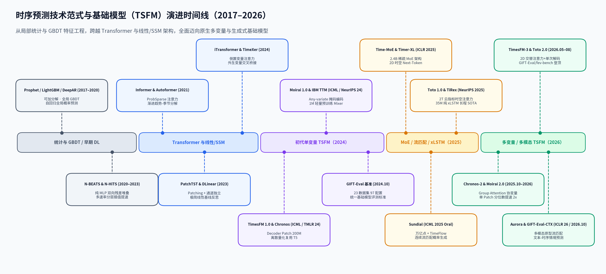
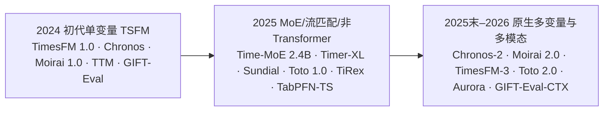

# 时序预测（Time Series Forecasting）前沿论文与技术（2024–2026）

> 更新时间：2026 年 11 月  
> 本文精选 2024–2026 年时序预测领域 13 篇里程碑论文与前沿基础模型（TSFMs），通过图像化演进时间线、多维参数与能力对比总表及代际拆解，系统呈现该方向从初代单变量预训练走向原生多变量/协变量、流匹配与多模态生成式预测的完整脉络。

## 1. 2024–2026 前沿演进时间线

## 2. 13 篇里程碑论文与基础模型多维对比总表

| 模型 / 论文 | 机构 / 主要作者 | 发表会议与年份 | 骨干架构与参数规模 | 预训练语料规模 | 多变量 / 协变量支持 | 概率输出机制 | 原始链接 |
| :--- | :--- | :--- | :--- | :--- | :--- | :--- | :--- |
| **TimesFM 1.0 → 3.0** | Google Research（Abhimanyu Das, Rajat Sen 等） | ICML 2024（1.0）· 2026.08（3.0） | Decoder-only Patch；1.0 (200M) → 2.0 (500M) → 2.5 (200M) → **3.0 (330M，2D 交替注意力)** | 1.0: 1000 亿点；3.0: **>1 万亿点**（真实+合成） | **3.0 原生多目标 + 过去/未来协变量** | 单次非自回归输出 9 个分位点（10%–90%） | [1.0 论文](https://arxiv.org/abs/2310.10688) · [3.0 博客](https://research.google/blog/timesfm-3-a-zero-shot-foundation-model-for-multivariate-forecasting/) · [GitHub](https://github.com/google-research/timesfm) |
| **Chronos → Chronos-2** | Amazon Science / AWS（Abdul Fatir Ansari 等） | TMLR 2024（1.0）· 2025.10 / 2026.10（2.0） | 1.0: T5 离散量化；**Chronos-2: 120M Encoder-only + Group Attention** | 大规模真实 + KernelSynth / VAR / RNN 合成数据 | **Chronos-2 原生多变量 + 过去/未来协变量** | 非参数分位数（含 0.01/0.99 极端分位点） | [1.0](https://arxiv.org/abs/2403.07815) · [Chronos-2](https://arxiv.org/abs/2510.15821) · [2026 扩展版](https://arxiv.org/html/2610.41956v1) · [GitHub](https://github.com/amazon-science/chronos-forecasting) |
| **Moirai 1.0 → MoE → 2.0** | Salesforce AI Research（Gerald Woo, Xu Liu 等） | ICML 2024 Oral（1.0）· 2024.10（MoE）· 2025.11（2.0） | 1.0: 掩码编码器；MoE: 稀疏专家；**2.0: 轻量 Decoder-only + 单 Patch** | 1.0: LOTSA；2.0: 3,600 万条序列 | 支持多变量与协变量 | 2.0 采用多 Token 分位数预测（Pinball Loss） | [1.0](https://arxiv.org/abs/2402.02592) · [MoE](https://arxiv.org/abs/2410.10469) · [2.0](https://arxiv.org/abs/2511.11698) · [GitHub](https://github.com/SalesforceAIResearch/uni2ts) |
| **Tiny Time Mixers (TTM)** | IBM Research（Vijay Ekambaram 等） | NeurIPS 2024 | 轻量级预训练 MLP-Mixer（TSMixer），**1M 参数起步** | 跨领域公开时序预训练 | 少样本外生变量混合微调 | 点预测为主（支持扩展） | [arXiv:2401.03955](https://arxiv.org/abs/2401.03955) · [Hugging Face](https://huggingface.co/ibm-granite/granite-timeseries-ttm-r2) |
| **Time-MoE** | 蚂蚁集团 / 普林斯顿等（Xiaoming Shi, Shiyu Wang 等） | ICLR 2025 Spotlight | 首个十亿级稀疏 MoE Decoder-only（最高 **2.4B 参数**） | **Time-300B**（3,000 亿时间点，9 领域） | 单变量为主（多分辨率预测头） | 点预测（支持 4096 上下文） | [arXiv:2409.16040](https://arxiv.org/abs/2409.16040) · [GitHub](https://github.com/Time-MoE/Time-MoE) |
| **Timer & Timer-XL** | 清华大学 THUML（Yong Liu, Mingsheng Long 等） | ICML 2024 / ICLR 2025 | 长上下文 Decoder-only + **2D TimeAttention** | 大规模跨领域长上下文语料 | **原生多变量与协变量** | 自回归点/多步预测 | [Timer](https://arxiv.org/abs/2402.02368) · [Timer-XL](https://arxiv.org/abs/2410.04803) · [GitHub](https://github.com/thuml/Timer-XL) |
| **Sundial** | 清华大学 THUML（Yong Liu 等） | ICML 2025 Oral（Top 1%） | 生成式 Transformer + **TimeFlow Loss** | **TimeBench（1 万亿时间点）** | 单变量为主（毫秒级采样） | **连续空间流匹配生成式概率分布** | [arXiv:2502.00816](https://arxiv.org/abs/2502.00816) · [GitHub](https://github.com/thuml/Sundial) |
| **TabPFN-TS** | 弗莱堡大学 / PriorLabs（Shi Bin Hoo, Frank Hutter 等） | arXiv 2025.01（2026 更新） | 表格基础模型 **TabPFN-v2** + 轻量时间特征工程 | 纯合成表格先验（零真实时序泄露） | 天然支持协变量与缺失值 | 单次前向输出离散黎曼概率分布 | [arXiv:2501.02945](https://arxiv.org/abs/2501.02945) · [GitHub](https://github.com/PriorLabs/tabpfn-time-series) |
| **TimeXer** | 清华大学 THUML（Yuxuan Wang, Haixu Wu 等） | NeurIPS 2024 | 专用 Transformer：内生 Patch + 外生交叉注意力 + 全局内生 Token | 领域内有监督训练 | **专精外生变量建模** | 点预测 | [arXiv:2402.19072](https://arxiv.org/abs/2402.19072) · [OpenReview](https://openreview.net/forum?id=INAeUQ04lT) |
| **TimeMixer++** | 蚂蚁集团 / 浙大等（Shiyu Wang 等） | ICLR 2025 Oral | 通用时序模式机（TSPM）：2D 多分辨率时间图像 + 分解混合 | 领域内有监督训练（8 大任务） | 多变量全任务支持 | 点预测 / 分类 / 插补 / 异常检测 | [arXiv:2410.16032](https://arxiv.org/abs/2410.16032) · [GitHub](https://github.com/kwuking/TimeMixer) |
| **Toto 1.0 → Toto 2.0** | Datadog（Ben Cohen 等） | NeurIPS 2025 / arXiv 2026.05 | 1.0: 151M 比例因子化时空注意力；2.0: u-μP 缩放 **4M–2.5B** | 1.0: **>2 万亿点**；2.0 含 57.5% TempoPFN 合成先验 | **高维多变量可观测性指标** | 1.0: Student-t 混合；2.0: 分位数输出 | [1.0](https://arxiv.org/abs/2505.14766) · [2.0](https://arxiv.org/html/2605.20119v2) · [GitHub](https://github.com/datadog/toto) |
| **TiRex** | NXAI（Andreas Auer 等） | NeurIPS 2025 | 纯 **xLSTM（sLSTM 块）** 非 Transformer（仅 **35M**）+ CPM | 跨领域真实 + 尖峰增强合成数据 | 单变量（长程状态追踪极强） | 非参数分位数输出 | [arXiv:2505.23719](https://arxiv.org/abs/2505.23719) · [GitHub](https://github.com/NX-AI/tirex) |
| **Aurora** | DecisionIntelligence（Xingjian Wu 等） | ICLR 2026 | **多模态生成式 TSFM**：模态引导自注意力 + 原型引导流匹配 | 多模态文本+数值时序语料 | **文本上下文 + 数值时序融合** | 原型引导连续流匹配生成分布 | [arXiv:2509.22295](https://arxiv.org/abs/2509.22295) · [GitHub](https://github.com/decisionintelligence/Aurora) |

## 3. 核心模型系列代际演进与技术拆解

### 3.1 Google TimesFM 系列（1.0 → 2.0 → 2.5 → TimesFM-3）
- **代际跃迁**：[TimesFM 1.0 (ICML 2024)](https://arxiv.org/abs/2310.10688) 奠定 Decoder-only Patch 预测范式（200M，1000 亿点）；[TimesFM 2.0](https://huggingface.co/google/timesfm-2.0-500m-pytorch) 扩容至 500M 参数与 2048 上下文；[TimesFM 2.5](https://huggingface.co/google/timesfm-2.5-200m-pytorch) 精简回 200M 并优化归一化。2026 年 8 月发布的 [TimesFM-3](https://research.google/blog/timesfm-3-a-zero-shot-foundation-model-for-multivariate-forecasting/)（330M，超 1 万亿真实与合成点）通过三大创新完成范式升级：
  1. **2D 交替注意力**：水平方向执行因果时间注意力、垂直方向执行跨变量全注意力；
  2. **连续 Patch 掩码单次非自回归解码（Contiguous Patch Masking）**：消除长步长自回归滚动误差；
  3. **原生多目标与协变量前瞻**：统一兼容多目标、历史协变量与未来已知协变量，单次输出 9 个分位点。
- **基准表现**：在 [GIFT-Eval](https://arxiv.org/html/2410.10393v2)、[fev-bench](https://arxiv.org/pdf/2509.26468) 与 [TIME](https://arxiv.org/html/2602.12147v4) 三大公开榜单均位列预训练模型第一（[BigQuery TimesFM 3.0 公告](https://cloud.google.com/blog/products/data-analytics/bigquery-timesfm-3-0-with-multivariate-time-series-forecasting)）。

### 3.2 Amazon Chronos 系列（Chronos → Chronos-Bolt → Chronos-2）
- **代际跃迁**：初代 [Chronos (TMLR 2024)](https://arxiv.org/abs/2403.07815) 通过数值缩放量化复用 T5 语言模型；Chronos-Bolt 转向 Patch 编码与直接多步分位数预测提速；[Chronos-2 (arXiv:2510.15821)](https://arxiv.org/abs/2510.15821)（[2026 扩展版](https://arxiv.org/html/2610.41956v1)）重构为 **120M Encoder-only + Group Attention（分组注意力）**，上下文最高支持 8,192 历史步与 1,024 预测步，输出含 0.01/0.99 极端分位数的分布，并结合 KernelSynth、VAR 因果图与随机 RNN 合成多变量动力学数据。
- **基准表现**：在 **fev-bench（100 项任务）** 上较 Chronos-Bolt 胜率超 90%，MASE/SQL 胜率领先最强统计集成 41.6/46.9 个百分点、领先 TiRex 9.0/7.2 个百分点，A10G GPU 上每 100 条序列仅耗时 0.8 秒（[Chronos-2 论文](https://arxiv.org/html/2610.41956v1)）。

### 3.3 Salesforce Moirai 系列（1.0 → Moirai-MoE → Moirai 2.0）
- **代际跃迁**：[Moirai 1.0 (ICML 2024 Oral)](https://arxiv.org/abs/2402.02592) 提出 Any-variate Attention 与多尺度 Patch 投影；[Moirai-MoE (2024.10)](https://arxiv.org/abs/2410.10469) 用单一投影层 + 内部稀疏 MoE 实现 Token 级自动频率专业化；[Moirai 2.0 (2025.11)](https://arxiv.org/abs/2511.11698) 践行“少即是多”，放弃掩码编码器与参数混合分布，改为 **Decoder-only + 单 Patch + 多 Token 分位数预测**，参数量比 1.0-Large **缩小 30 倍、推理快 2 倍**且全面反超前代大模型。

### 3.4 轻量化与十亿级 MoE 两极探索：IBM TTM 与 Time-MoE
- **[IBM TTM (NeurIPS 2024)](https://arxiv.org/abs/2401.03955)**：基于 MLP-Mixer 与自适应分块，仅 **1M 参数起步**，在零样本与 5% 数据少样本微调中媲美十亿级模型，支持普通笔记本 CPU 推理与微调（[Hugging Face](https://huggingface.co/ibm-research/ttm-research-r2)）。
- **[Time-MoE (ICLR 2025 Spotlight)](https://arxiv.org/abs/2409.16040)**：首次从零将时序基础模型扩展至 **2.4B 参数**，推理时稀疏激活部分专家并配套开源 **Time-300B**（3,000 亿点）预训练语料。

### 3.5 清华 THUML 体系：Timer-XL、Sundial 与 TimeXer
- **[Timer-XL (ICLR 2025)](https://arxiv.org/abs/2410.04803)**：以 2D **TimeAttention** 将 Next-Token Prediction 从一维推广至多变量时空序列。
- **[Sundial (ICML 2025 Oral)](https://arxiv.org/abs/2502.00816)**：在万亿点 TimeBench 预训练，以 **TimeFlow Loss**（连续空间流匹配）替代离散量化，实现毫秒级多峰概率轨迹采样；该团队 2026 年 3 月进一步发布了十亿级串行扩展技术报告 [Timer-S1](https://www.researchgate.net/publication/401600997_Timer-S1_A_Billion-Scale_Time_Series_Foundation_Model_with_Serial_Scaling)。
- **[TimeXer (NeurIPS 2024)](https://arxiv.org/abs/2402.19072)**：面向外生变量预测，通过内生 Patch 自注意力、外生变量交叉注意力与全局内生 Token 桥接，在 12 个外生基准取得一致 SOTA。

### 3.6 垂直高维、非 Transformer、上下文先验与多模态新范式
- **[Toto 1.0 (NeurIPS 2025)](https://arxiv.org/abs/2505.14766) → [Toto 2.0 (2026)](https://arxiv.org/html/2605.20119v2)**：面向高维云可观测性指标，1.0 在 BOOM 上较 Moirai-Base 降 13.1% MASE 与 12.4% CRPS；2.0 通过 u-μP 扩展至 4M–2.5B 参数族，并融入 57.5% 基于 [TempoPFN](https://arxiv.org/html/2510.25502v1) 的合成先验。
- **[TiRex (NeurIPS 2025)](https://arxiv.org/abs/2505.23719)**：仅 **35M 参数**的纯 **xLSTM（sLSTM 块）** 架构配连续 Patch 掩码，在 GIFT-Eval 取得 **0.411 CRPS**。
- **[TabPFN-TS (2025–2026)](https://arxiv.org/abs/2501.02945)**：复用纯合成数据预训练的表格基础模型 **TabPFN-v2** + 轻量时间特征，单次前向输出黎曼分布，天然免疫数据泄露且兼容缺失值。
- **[TimeMixer++ (ICLR 2025 Oral)](https://arxiv.org/abs/2410.16032)**：将多尺度多周期时序映射为 2D 多分辨率时间图像，横扫 8 大时序任务。
- **[Aurora (ICLR 2026)](https://arxiv.org/abs/2509.22295)**：首个零样本多模态生成式 TSFM，通过模态引导自注意力与原型引导流匹配打通文本上下文与数值概率预测。

## 4. 2025–2026 年五大核心技术趋势

1. **架构收敛于“原生多变量/协变量 + 非参数分位数 + 单次非自回归解码”**：[TimesFM-3](https://research.google/blog/timesfm-3-a-zero-shot-foundation-model-for-multivariate-forecasting/)、[Chronos-2](https://arxiv.org/abs/2510.15821) 与 [Moirai 2.0](https://arxiv.org/abs/2511.11698) 一致抛弃了慢速离散自回归，转向连续 Patch 掩码并行解码与极端分位数校准。
2. **连续流匹配生成取代离散分桶**：[Sundial](https://arxiv.org/abs/2502.00816) 与 [Aurora](https://arxiv.org/abs/2509.22295) 证明流匹配能够在连续值域直接刻画偏态与多峰不确定性，兼具高采样效率与分布表达力。
3. **高质量结构化合成先验成为扩展核心引擎**：[TabPFN-TS](https://arxiv.org/abs/2501.02945)、[Chronos-2](https://arxiv.org/html/2610.41956v1) 与 [Toto 2.0](https://arxiv.org/html/2605.20119v2)（TempoPFN）用因果图/动力学合成数据打破真实多变量语料稀缺瓶颈。
4. **轻量化与非 Transformer 骨干复兴**：xLSTM（[TiRex](https://arxiv.org/abs/2505.23719)）、稀疏 MoE（[Time-MoE](https://arxiv.org/abs/2409.16040)）与微型 MLP-Mixer（[TTM](https://arxiv.org/abs/2401.03955)）在边缘与高吞吐工业场景持续拉开性价比优势。
5. **防泄露与情境化评测体系升级**：评测标准全面从传统小样本数据集转向涵盖协变量的 [fev-bench](https://arxiv.org/pdf/2509.26468)、严格时间防泄露的 [TIME (2026)](https://arxiv.org/html/2602.12147v4) 与融合文本情境的 [GIFT-Eval-CTX (2026)](https://arxiv.org/html/2610.17794v1)。
