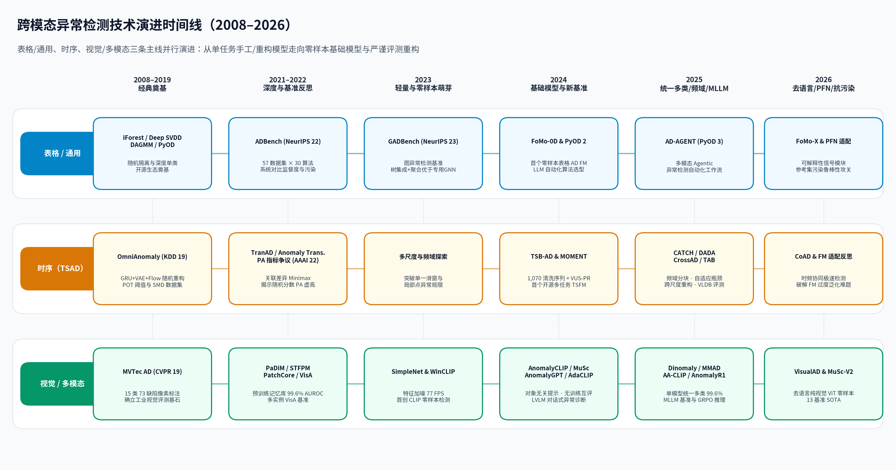
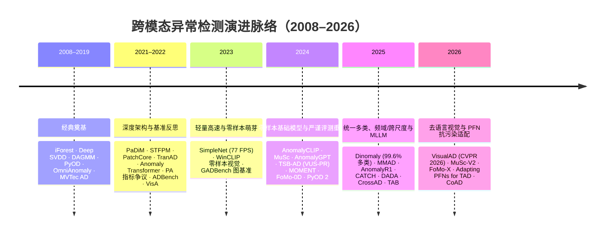

# 异常检测（Anomaly Detection）技术概括介绍

> 更新时间：2026 年 11 月  
> 本文系统拆解异常检测的定义、异常类型与学习范式，深入剖析表格、时序、工业视觉、图与日志四大模态核心技术路线的底层算法原理与数学机制，并提供跨模态算法对比矩阵、评估指标陷阱解析（Point Adjustment 争议与 VUS-PR）以及主流基准与工程工具生态。

## 1. 定义、异常类型与学习范式

**异常检测（Anomaly Detection, AD，又称离群点检测 Outlier Detection）** 旨在识别数据中显著偏离预期“正常”分布或行为模式的罕见观测样本（[Chandola et al., ACM Computing Surveys 2009](https://scispace.com/papers/anomaly-detection-a-survey-1x33g9m0a3) · [Isolation-Based AD Survey, 2024](https://arxiv.org/html/2403.10802v1)）。

### 1.1 三大经典异常类型
- **点异常（Point Anomalies）**：单个数据实例相对于全局分布显著偏离（如异常大额盗刷交易、服务器 CPU 瞬时尖峰）。
- **上下文异常（Contextual / Conditional Anomalies）**：仅在特定时间、空间或环境条件下异常（如冬季正常但夏季异常的供暖负荷）。
- **群体/序列异常（Collective / Subsequence Anomalies）**：单点本身处于正常值域，但一组相关观测或连续子序列整体偏离正常模式（如时序周期破坏、形态漂移或异常系统日志执行路径）（[TAB Survey, VLDB 2025](https://arxiv.org/html/2506.18046v1)）。

### 1.2 四类学习范式对比

| 学习范式 | 训练集标注假设 | 现实落地痛点 | 典型代表 |
| :--- | :--- | :--- | :--- |
| **无监督（Unsupervised / Contaminated）** | 完全无标签，且可能混杂未知比例异常污染 | 污染率过高会拉偏正常边界；缺乏验证集调参（[ADBench](https://arxiv.org/html/2206.09426v2)） | Isolation Forest · LOF · [FoMo-0D](https://arxiv.org/abs/2409.05672) |
| **单类/半监督（One-Class / Clean）** | 仅含干净正常样本（视觉与时序领域常称 UAD） | 需人工清洗正常训练集；易产生“恒等映射”过拟合 | Deep SVDD · PatchCore · [Dinomaly](https://arxiv.org/abs/2405.14325) |
| **弱监督/有监督** | 极少量已知异常样本或粗粒度（图像/视频级）标签 | 易过拟合已知异常类型，对开放集未知缺陷（Open-Set）漏检 | DevNet · 弱监督视频异常检测 |
| **零样本/少样本（ZSAD / FSAD）** | 目标类别 0 样本或仅 1–4 张正常参考样本 | 依赖预训练基础模型跨领域表征能力（[WinCLIP](https://arxiv.org/abs/2303.14814)） | [AnomalyCLIP](https://arxiv.org/abs/2310.18961) · [MuSc](https://arxiv.org/abs/2401.16753) · [VisualAD](https://arxiv.org/abs/2603.07952) |

## 2. 跨模态演进时间线

## 3. 四大模态核心技术路线底层原理拆解

### 3.1 表格与通用数据异常检测（Tabular / General AD）
1. **基于随机隔离的树集成 — [Isolation Forest (ICDM 2008)](https://www.semanticscholar.org/paper/Isolation-Based-Anomaly-Detection-Liu-Ting/dcd9f5d61bc9a70c40be84a8d78fbee822ffcd9e)**：利用异常“稀少且特征值偏离”的几何特性，递归随机选取特征与切分点构建孤立树（iTree）。样本 $x$ 在森林中的平均路径长度 $E(h(x))$ 越短越容易被孤立，其归一化异常分数为 $s(x, n) = 2^{-E(h(x))/c(n)}$（$c(n)$ 为二叉搜索树平均路径长度）。具备 $O(n)$ 线性复杂度，对高维数据扩展性极佳。
2. **基于局部密度与距离 — LOF & kNN**：LOF（Local Outlier Factor）通过计算样本 $x$ 的局部可达密度 $\text{lrd}_k(x)$ 与其 $k$ 近邻平均局部可达密度的比值打分；比值显著大于 1 表示处于低密度稀疏区，擅长解决全局密度不均时的局部离群点检测（[Adapting PFNs for TAD, 2026](https://arxiv.org/html/2610.06693v1)）。
3. **基于单类边界 — One-Class SVM 与 [Deep SVDD (ICML 2018)](https://proceedings.mlr.press/v80/ruff18a.html)**：Deep SVDD 训练神经网络 $\phi(\cdot; \mathcal{W})$ 将正常样本映射到以中心 $\mathbf{c}$ 为球心的最小体积超球体内，目标函数 $\min_{\mathcal{W}} \frac{1}{n}\sum \|\phi(x_i; \mathcal{W}) - \mathbf{c}\|^2 + \frac{\lambda}{2}\|\mathcal{W}\|_F^2$；为防止所有输入坍缩到常数点 $\mathbf{c}$，要求网络去除偏置项并避免有界激活函数。
4. **联合重构与深度密度估计 — [DAGMM (ICLR 2018)](https://openreview.net/forum?id=BJJLHbb0-)**：将压缩网络（深度自编码器，输出低维潜向量 $z_c$ 与重构误差特征 $z_r$）与估计网络（预测高斯混合模型 GMM 成员归属）端到端联合优化，以样本能量（负对数密度）作为异常分数，避免自编码器仅靠重构误差丢失潜在分布信息的缺陷。
5. **零样本先验拟合网络（PFN）路线**：[FoMo-0D (2024/2025)](https://arxiv.org/abs/2409.05672) 在合成高斯混合先验上预训练 Transformer，推理时以单次上下文前向直接输出离群概率，免去目标数据集上的训练与超参搜索。
6. **开源工具生态**：[PyOD (JMLR 2019)](https://www.jmlr.org/papers/volume20/19-011/19-011.pdf)（[GitHub](https://github.com/yzhao062/pyod)）已演进至 [PyOD 2 (2024)](https://arxiv.org/abs/2412.12154)（统一 45 种算法与 LLM 自动模型选择）及多模态 Agent 框架 [AD-AGENT](https://usc-fortis.github.io/AD-AGENT/)。

### 3.2 时序异常检测（Time Series Anomaly Detection, TSAD）
1. **随机重构与极值阈值 — [OmniAnomaly (KDD 2019)](https://www.kdd.org/kdd2019/accepted-papers/view/robust-anomaly-detection-for-multivariate-time-series-through-stochastic-re) 与 [TranAD (VLDB 2022)](https://arxiv.org/abs/2201.07284)**：OmniAnomaly 结合 GRU、VAE 与 Planar Normalizing Flow 捕捉多变量时序的随机非线性依赖，以对数重构概率打分，并用极值理论 **POT（Peaks-Over-Threshold）** 动态确定报警阈值；TranAD 采用双阶段 Transformer + Focus Score 自条件化与对抗训练，放大微小异常的重构偏差。
2. **关联差异对比 — [Anomaly Transformer (ICLR 2022)](https://arxiv.org/abs/2110.02642)**：提出 **Association Discrepancy（关联差异）** 理论——正常点能与全局周期建立远距离关联（Series-Association 分布广），而异常点罕见，注意力被迫集中在相邻时间步（与局部高斯核 Prior-Association 高度接近，KL 散度小）；通过 Minimax 双阶段策略拉大正常与异常的关联差异。
3. **频域分块与跨尺度重构 — [CATCH (ICLR 2025)](https://arxiv.org/abs/2410.12261) 与 [CrossAD (NeurIPS 2025)](https://arxiv.org/abs/2510.12489)**：CATCH 通过 FFT 将多变量时序转入频域并按频带分块融合通道相关性，兼顾高频点异常与低频周期异常；CrossAD 通过“由粗粒度重构细粒度”显式捕获异常时的跨尺度关联破坏，并用查询库突破固定滑窗限制。
4. **通用时序基础模型迁移与瓶颈调控 — [MOMENT (ICML 2024)](https://arxiv.org/abs/2402.03885) 与 [DADA (2025)](https://arxiv.org/html/2405.15273v4)**：直接用通用预测/重构基础模型容易因容量过大而“把异常也完美重构”（[Adapting FMs for TSAD, 2026](https://arxiv.org/html/2610.06453v1)）；DADA 提出**自适应瓶颈（Adaptive Bottlenecks）**与双对抗解码器，按领域动态压缩表征容量并显式拉大正常-异常边界。

### 3.3 视觉与工业表面缺陷异常检测（Visual / Industrial AD）
1. **预训练特征分布与记忆库 — [PaDiM (ICPR 2021)](https://arxiv.org/abs/2011.08785) 与 [PatchCore (CVPR 2022)](https://arxiv.org/abs/2106.08265)**：PaDiM 在每个空间坐标用冻结 CNN 多尺度特征拟合多元高斯分布，推理以马氏距离定位；PatchCore 提取局部邻域感知中层 Patch 特征，通过**贪心 Coreset 降采样**压缩记忆库，以最大最近邻距离打分，在 MVTec AD 上达成 **99.6% 图像级 AUROC**。
2. **知识蒸馏（师生网络） — [STFPM (BMVC 2021)](https://arxiv.org/abs/2103.04257)**：仅在正常样本上训练随机初始化学生网络去匹配冻结教师网络的多尺度特征金字塔，推理时缺陷区域会触发显著的师生特征余弦距离差异。
3. **特征空间合成异常 — [SimpleNet (CVPR 2023)](https://arxiv.org/abs/2303.15140)**：在适配后的预训练特征上直接叠加高斯噪声合成异常特征，仅用轻量 MLP 判别器即可在 MVTec AD 取得 **99.6% AUROC** 且推理速度达 **77 FPS**。
4. **单模型统一多类重构 — [Dinomaly (CVPR 2025)](https://arxiv.org/abs/2405.14325)**：用 DINOv2 + Noisy Bottleneck（Dropout）+ Linear Attention + 宽松重构打破多类统一模型的恒等映射退化，单模型在 MVTec AD 同样达到 **99.6% AUROC**。
5. **零样本视觉-语言与纯视觉路线 — [WinCLIP](https://arxiv.org/abs/2303.14814) → [AnomalyCLIP](https://arxiv.org/abs/2310.18961) → [MuSc](https://arxiv.org/abs/2401.16753) → [VisualAD](https://arxiv.org/abs/2603.07952)**：从手工组合文本提示（WinCLIP），演进到对象无关可学习提示与 V-V 注意力（AnomalyCLIP）、无训练批量互评分（MuSc），直至 2026 年去语言分支的纯 ViT 零样本框架（VisualAD）。工业工程生态以 [Anomalib](https://www.codemajin.net/anomalib-image-anomaly-detection/) 为主流。

### 3.4 图、日志与多模态 AIOps 异常检测
- **图异常检测（GAD）**：面向金融反欺诈与网络入侵，检测异常节点/边/子图。[GADBench (NeurIPS 2023)](https://arxiv.org/abs/2306.12251) 在 10 个真实图数据集（最大约 600 万节点）实证表明：**带简单邻域聚合的树集成模型常优于专门设计的 GNN 异常检测器**；2026 年最新探索正将表格基础模型（TabPFN）迁移至图异常检测（[arXiv:2601.17301](https://arxiv.org/pdf/2601.17301)）。
- **日志与多模态 AIOps**：[DeepLog (ACM CCS 2017)](https://users.cs.utah.edu/~lifeifei/papers/deeplog.pdf) 将日志模板序列建模为下一事件预测并支持工作流根因定位；2026 年云原生/5G 遥测评估研究（[TU Delft 2026](https://repository.tudelft.nl/file/File_368e65a3-682c-489a-9040-d1dbd32018bb)）证实**日志、指标与分布式追踪存在强互补性**，联合多模态遥测可将 22 类故障覆盖率从单模态最高的 19/22 提升至 21/22。

## 4. 跨模态经典算法多维对比与工程选型矩阵

| 模态 | 技术路线 | 代表算法 | 正常数据需求 | 推理速度 | 定位/可解释性 | 核心优势 | 主要短板 | 推荐落地场景 |
| :--- | :--- | :--- | :--- | :--- | :--- | :--- | :--- | :--- |
| **表格** | 随机隔离树 | [Isolation Forest](https://www.semanticscholar.org/paper/Isolation-Based-Anomaly-Detection-Liu-Ting/dcd9f5d61bc9a70c40be84a8d78fbee822ffcd9e) | 无监督（抗轻度污染） | 极快（CPU 毫秒级） | 中（特征路径深度） | 线性复杂度、免调参基线稳健 | 轴平行切分对局部/复杂流形弱 | 金融风控初筛、通用表格快速基线 |
| **表格** | 零样本基础模型 | [FoMo-0D](https://arxiv.org/abs/2409.05672) · [FoMo-X](https://arxiv.org/html/2603.17570v1) | 零样本 / 少量参考集 | 中（GPU 单次前向） | 强（FoMo-X 归因） | 免训练、免超参敏感性、跨表泛化 | 需防参考集高比例污染 | 小样本新业务冷启动、自动化数据质检 |
| **时序** | 随机/频域/多尺度 | [OmniAnomaly](https://www.kdd.org/kdd2019/accepted-papers/view/robust-anomaly-detection-for-multivariate-time-series-through-stochastic-re) · [CATCH](https://arxiv.org/abs/2410.12261) · [CrossAD](https://arxiv.org/abs/2510.12489) | 需域内正常历史 | 快–中 | 中（通道/频段残差） | 精准捕捉多变量相关性与子序列异常 | 跨业务迁移需重训 | 工业设备监控、数据中心核心指标 |
| **时序** | 通用基础模型 | [MOMENT](https://arxiv.org/abs/2402.03885) · [DADA](https://arxiv.org/html/2405.15273v4) | 零样本（一模多用） | 中 | 中 | 跨领域冷启动成本极低 | 需调控瓶颈避免过度重构异常 | 海量长尾云监控指标（AIOps） |
| **视觉** | 特征记忆库/合成 | [PatchCore](https://arxiv.org/abs/2106.08265) · [SimpleNet](https://arxiv.org/abs/2303.15140) | 单类正常图（数十–数百张） | **极快（77 FPS）** | **像素级热力图** | 工业产线精度天花板（99.6% AUROC） | 每类需独立维护模型 | 固定产线高精度 AOI 表面质检 |
| **视觉** | 多类统一/零样本 | [Dinomaly](https://arxiv.org/abs/2405.14325) · [AnomalyCLIP](https://arxiv.org/abs/2310.18961) · [VisualAD](https://arxiv.org/abs/2603.07952) | 多类统一或 0 样本 | 快–中 | 像素级 + 语言推理（MLLM） | 极大降低多 SKU 模型运维成本 | 极端微小缺陷仍弱于专用单类模型 | 多品类柔性制造、跨领域医疗初筛 |

## 5. 核心挑战与评估指标陷阱

1. **极度类别不平衡与 AUROC 虚高陷阱**：当异常占比极低（如像素级分割仅占 0.1% 面积）时，极高的真阴性数量会掩盖大量误报。[VisA (ECCV 2022)](https://arxiv.org/abs/2207.14315) 实证指出像素 AUROC 高达 93%+ 时，AU-PR 可能仅约 10%，因此必须联合 **AU-PR / AP、F1-max 与 AUPRO** 评测。
2. **Point Adjustment（PA）评估陷阱与 VUS-PR 重构**：
   - 早期时序论文普遍采用 **Point Adjustment（点调整）**——只要一段连续异常中有**任意一个时间点**报警，就将整段异常全部算作检出。
   - [Kim et al. (AAAI 2022)](https://ojs.aaai.org/index.php/AAAI/article/view/20680)（[arXiv:2109.05257](https://arxiv.org/abs/2109.05257)）证明 PA 会严重扭曲排名，甚至**纯随机生成的异常分数在 PA 下也能轻松跑出“SOTA” F1**。
   - 当前学术界已全面转向无阈值、对边界容忍更平滑的指标，其中 [TSB-AD (NeurIPS 2024)](https://openreview.net/forum?id=R6kJtWsTGy) 将 **VUS-PR（Volume Under the Surface - Precision-Recall）** 确立为最可靠的时序异常检测指标。
3. **训练污染与无监督超参敏感性**：真实无监督数据常含未察觉异常（[Adapting PFNs for TAD, 2026](https://arxiv.org/html/2610.06693v1) 显示参考集污染可使原始 kNN 掉点 11 个 AUROC），且深度异常检测器在无标签验证时对超参极度敏感（[Hyperparameter Sensitivity in Deep OD](https://arxiv.org/html/2206.07647)）。
4. **从“分数报警”到“可解释诊断”的鸿沟**：工业运维需要知道缺陷类别、严重等级与根因建议而非单一标量阈值，催生了 [AnomalyGPT](https://arxiv.org/abs/2308.15366)、[MMAD](https://arxiv.org/abs/2410.09453) 与 [FoMo-X](https://arxiv.org/html/2603.17570v1) 等可解释/推理式方向。

## 6. 主流公开基准数据集全景

| 模态 | 基准名称 | 规模与核心特点 | 原始链接 |
| :--- | :--- | :--- | :--- |
| **表格/通用** | **ADBench** | 57 个数据集（47 经典 + 10 新建），系统评测 30 种算法在不同监督度、异常类型与污染率下的表现 | [NeurIPS 2022 / arXiv:2206.09426](https://arxiv.org/abs/2206.09426) · [GitHub](https://github.com/Minqi824/ADBench) |
| **工业视觉** | **MVTec AD** | 15 类（5 纹理 + 10 物体）、5,354 张高分辨率图像、73 种缺陷与像素级标注（现已趋近饱和） | [CVPR 2019 Open Access](https://openaccess.thecvf.com/content_CVPR_2019/html/Bergmann_MVTec_AD_--_A_Comprehensive_Real-World_Dataset_for_Unsupervised_Anomaly_CVPR_2019_paper.html) |
| **工业视觉** | **VisA** | 12 类物体、10,821 张图像（9,621 正常 + 1,200 异常），含 PCB 等复杂结构与多实例场景 | [ECCV 2022 / arXiv:2207.14315](https://arxiv.org/abs/2207.14315) |
| **工业视觉（进阶）** | **MVTec AD 2 / MMAD** | MVTec AD 2 引入极端光照与复杂场景；MMAD 面向 MLLM 包含 8,366 张图与 39,672 问答对 | [MVTec AD 2](https://arxiv.org/pdf/2503.21622) · [MMAD (ICLR 2025)](https://arxiv.org/abs/2410.09453) |
| **时序** | **TSB-AD** | 精选清洗自 40 个数据集的 1,070 条高质量单/多变量时序，公平评测 40 种算法，推荐 VUS-PR | [NeurIPS 2024](https://openreview.net/forum?id=R6kJtWsTGy) · [GitHub](https://github.com/thedatumorg/TSB-AD) |
| **时序** | **TAB** | 29 个多变量数据集 + 1,635 条单变量时序，统一评测统计、深度、LLM 与时序基础模型 | [VLDB 2025 / arXiv:2506.18046](https://arxiv.org/html/2506.18046v1) |
| **时序（经典）** | **SMD / SMAP / MSL** | 服务器监控（SMD，出自 OmniAnomaly）与航天遥测经典数据集，现常与 TSB-AD 配合使用 | [OmniAnomaly / SMD](https://github.com/NetManAIOps/OmniAnomaly) |
| **图数据** | **GADBench** | 10 个真实静态属性图（数千至约 600 万节点），评测 23–29 种图异常检测模型 | [NeurIPS 2023 / arXiv:2306.12251](https://arxiv.org/abs/2306.12251) |
