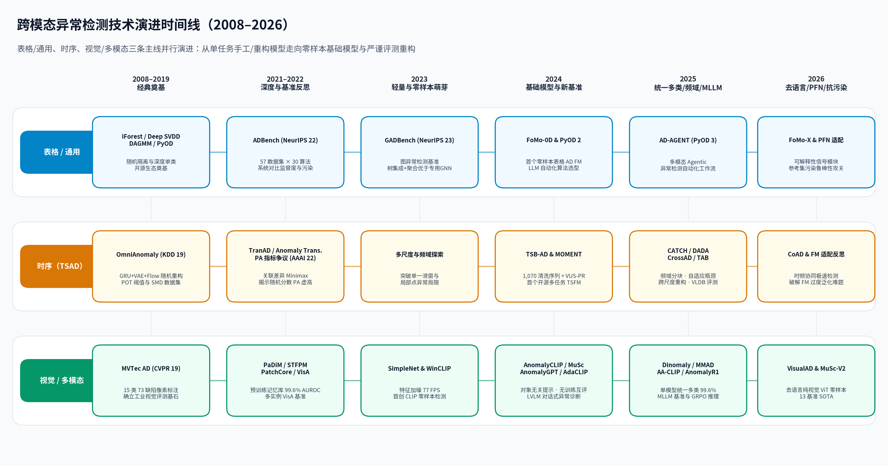
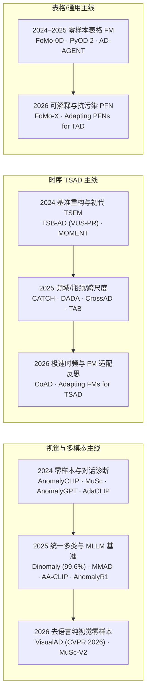

# 异常检测（Anomaly Detection）前沿论文与技术（2024–2026）

> 更新时间：2026 年 11 月  
> 本文精选 2024–2026 年异常检测领域 12 篇顶会与前沿突破性论文，均衡覆盖**视觉/多模态（5 篇）**、**时序（5 篇）** 与 **表格/通用基础模型（2 篇）**，通过跨模态图像化时间线、多维对比总表与深度拆解，系统呈现该领域的最新演进。

## 1. 2024–2026 跨模态前沿演进时间线

## 2. 2024–2026 前沿论文多维对比总表

| 论文 / 模型 | 所属模态 | 机构 / 主要作者 | 发表会议与年份 | 学习设定 | 核心技术创新 | 代表性基准表现 | 原始链接 |
| :--- | :--- | :--- | :--- | :--- | :--- | :--- | :--- |
| **AnomalyCLIP** | 视觉/多模态 | 浙江大学、SMU（Qihang Zhou, Guansong Pang 等） | ICLR 2024 | 零样本（ZSAD） | 对象无关可学习文本提示 + DPAM 注意力 | MVTec AD **91.5%/91.1%**；VisA **82.1%/95.5%**（图/像素 AUROC） | [arXiv:2310.18961](https://arxiv.org/abs/2310.18961) · [GitHub](https://github.com/zqhang/AnomalyCLIP) |
| **MuSc / MuSc-V2** | 视觉/多模态 | 华中科技大学、特伦托大学（Xurui Li 等） | ICLR 2024 / TPAMI 2025–2026 | 无训练零样本 | 批量无标签图像多尺度互评分（Mutual Scoring），免文本提示 | 免训练、免辅助集下在 MVTec AD / VisA 取得领先零样本精度 | [arXiv:2401.16753](https://arxiv.org/abs/2401.16753) · [MuSc-V2](https://arxiv.org/html/2511.10047v2) |
| **Dinomaly** | 视觉（多类 UAD） | 北京理工大学、清华大学（Jia Guo 等） | CVPR 2025 | 统一多类单模型 | DINOv2 + Noisy Bottleneck + Linear Attention + 宽松重构 | MVTec **99.6%/98.2%** · VisA **98.7%/97.5%** · Real-IAD **89.3%** | [arXiv:2405.14325](https://arxiv.org/abs/2405.14325) · [CVPR 2025](https://openaccess.thecvf.com/content/CVPR2025/html/Guo_Dinomaly_The_Less_Is_More_Philosophy_in_Multi-Class_Unsupervised_Anomaly_CVPR_2025_paper.html) |
| **MMAD**（及 AnomalyR1） | 视觉 + MLLM | 南科大、腾讯优图、上交大等（Xi Jiang 等） | ICLR 2025 | MLLM 推理评测 | 7 大工业子任务、8,366 图、39,672 问答对全谱系基准 | 揭示 GPT-4o 平均仅 **74.9%**，催生 GRPO 推理模型 [AnomalyR1](https://arxiv.org/abs/2504.11914) | [arXiv:2410.09453](https://arxiv.org/abs/2410.09453) · [GitHub](https://github.com/jam-cc/mmad) |
| **VisualAD** | 视觉（去语言） | Yanning Hou, Peiyuan Li, Ke Xu 等 | CVPR 2026 | 零样本（ZSAD） | 纯视觉无语言分支：冻结 ViT + 可学习正常/异常 Token + SCA/SAF | 跨工业与医疗 **13 个零样本基准** SOTA，兼容 CLIP 与 DINOv2 | [CVPR 2026](https://openaccess.thecvf.com/content/CVPR2026/html/Hou_VisualAD_Language-Free_Zero-Shot_Anomaly_Detection_via_Vision_Transformer_CVPR_2026_paper.html) · [arXiv:2603.07952](https://arxiv.org/abs/2603.07952) |
| **TSB-AD** | 时序基准 | 俄亥俄州立大学（Qinghua Liu, John Paparrizos） | NeurIPS 2024 D&B | 基准与指标重构 | 40 数据集清洗出 1,070 条高质量时序 + 40 算法公平评测 | 确立 **VUS-PR** 指标；揭示单变量下简洁统计/ML 常优于深度网 | [OpenReview](https://openreview.net/forum?id=R6kJtWsTGy) · [GitHub](https://github.com/thedatumorg/TSB-AD) |
| **MOMENT** | 时序基础模型 | CMU、宾大等（Mononito Goswami 等） | ICML 2024 | 零样本 / 微调 | 首个开源多任务时序基础模型（Masked Time-Series Modeling） | 零样本下在 UCR 档案 44 条时序上展现出强竞争力 | [arXiv:2402.03885](https://arxiv.org/abs/2402.03885) · [GitHub](https://github.com/moment-timeseries-foundation-model/moment) |
| **CATCH** | 时序（频域） | DecisionIntelligence（Xingjian Wu 等） | ICLR 2025 | 无监督多变量 | 频域分块（Frequency Patching）+ 通道感知融合 | 同步高精度检测异构点异常与周期/形态子序列异常 | [arXiv:2410.12261](https://arxiv.org/abs/2410.12261) · [GitHub](https://github.com/decisionintelligence/CATCH) |
| **DADA** | 时序通用基础模型 | Qichao Shentu 等 | arXiv 2025（v4） | 跨领域零样本 | 自适应瓶颈（Adaptive Bottlenecks）+ 双对抗解码器 | 零样本“一模多用”媲美或超越单数据集专用 SOTA 模型 | [arXiv:2405.15273](https://arxiv.org/html/2405.15273v4) |
| **CrossAD** | 时序（多尺度） | Beibu Li, Qichao Shentu, Yang Shu 等 | NeurIPS 2025 | 无监督多变量 | 跨尺度由粗到细关联重构 + 查询库跨窗口全局多尺度建模 | 多个真实数据集 9 项评估指标上取得一致 SOTA | [arXiv:2510.12489](https://arxiv.org/abs/2510.12489) · [NeurIPS 2025](https://neurips.cc/virtual/2025/poster/116814) |
| **FoMo-0D**（及 FoMo-X） | 表格基础模型 | Leman Akoglu 等 | arXiv 2024–2026 | 零样本 ICL | 基于合成高斯混合先验的零样本表格离群点基础模型 + 可解释扩展 | 免训练单次前向推理，跨表零样本性能优异 | [arXiv:2409.05672](https://arxiv.org/abs/2409.05672) · [FoMo-X](https://arxiv.org/html/2603.17570v1) · [GitHub](https://github.com/A-Chicharito-S/FoMo-0D) |
| **Adapting PFNs for TAD** | 表格基础模型 | 2026 前沿研究 | arXiv 2026 | 零/少样本抗污染 | 先验拟合网络（PFN / TabPFN）在参考集污染下的表格异常检测适配 | 量化参考集污染影响（原始 kNN 掉点 11 AUROC）并提出鲁棒策略 | [arXiv:2610.06693](https://arxiv.org/html/2610.06693v1) · [From Zero to Hero](https://arxiv.org/abs/2602.03018) |

## 3. 重点论文深度解析

### 3.1 视觉与多模态零样本 / 基础模型异常检测

#### 1. AnomalyCLIP（ICLR 2024）
- **英文原标题**：*AnomalyCLIP: Object-agnostic Prompt Learning for Zero-shot Anomaly Detection*
- **核心创新**：针对原生 CLIP 偏向物体前景类别而非细粒度缺陷状态的问题，提出**对象无关的可学习文本提示（Object-agnostic Prompt Learning）**，专门学习通用的“正常/异常”状态语义；并将视觉编码器深层自注意力替换为对角占优注意力（DPAM），联合优化全局与局部损失。
- **关键结论**：在跨数据集零样本设定下，于 MVTec AD 取得 **91.5% 图像级 AUROC / 91.1% 像素级 AUROC**，在 VisA 取得 **82.1% 图像级 / 95.5% 像素级 AUROC**，并能直接迁移至多类医疗影像缺陷检测（[arXiv:2310.18961](https://arxiv.org/abs/2310.18961)）。

#### 2. MuSc（ICLR 2024）与 MuSc-V2（2025–2026）
- **英文原标题**：*MuSc: Zero-Shot Industrial Anomaly Classification and Segmentation with Mutual Scoring of the Unlabeled Images*
- **核心创新**：完全摆脱文本提示词与辅助训练集依赖，提出**无训练（Training-Free）的批量无标签图像互评分机制（Mutual Scoring）**——利用同一批次待测工业图像中正常 Patch 占绝大多数的隐式先验，通过多尺度局部 Patch 聚合与相互相似度计算实现零样本分类与像素定位（[arXiv:2401.16753](https://arxiv.org/abs/2401.16753)）。其扩展版 [MuSc-V2](https://arxiv.org/html/2511.10047v2) 进一步拓展至多模态场景。

#### 3. Dinomaly（CVPR 2025）
- **英文原标题**：*Dinomaly: The Less Is More Philosophy in Multi-Class Unsupervised Anomaly Detection*
- **核心创新**：攻克“单模型统一检测所有工业类别（Multi-Class UAD）”中常见的恒等映射（Identity Mapping）退化问题，提出仅由 Attention 与 MLP 组成的极简纯 Transformer 重构架构，核心为四要素：（1）DINOv2-R 视觉基础编码器；（2）**Noisy Bottleneck**（利用 Dropout 注入噪声打破恒等捷径）；（3）**Linear Attention**（抑制局部直接复制）；（4）**Loose Reconstruction**（分组宽松约束）。
- **关键结论**：在统一多类设定下，**MVTec AD 图像级 AUROC 达 99.6%（像素级 98.2%）、VisA 达 98.7%（像素级 97.5%）、Real-IAD 达 89.3%**，首次使单模型多类检测全面追平甚至超越最先进单类专用模型（[arXiv:2405.14325](https://arxiv.org/abs/2405.14325)）。

#### 4. MMAD（ICLR 2025）与 MLLM 推理式检测（AnomalyGPT / AnomalyR1）
- **英文原标题**：*MMAD: A Comprehensive Benchmark for Multimodal Large Language Models in Industrial Anomaly Detection*
- **核心创新**：继 [AnomalyGPT (AAAI 2024 Oral)](https://arxiv.org/abs/2308.15366) 将多模态大模型引入工业异常检测并消除手工阈值后，MMAD 构建了涵盖 **8,366 张工业图像与 39,672 个多模态问答对** 的全谱系评测基准，定义异常判定、缺陷分类、定位、描述与成因分析等 7 大子任务。
- **关键结论**：即便是当时领先的商业模型 **GPT-4o 平均准确率也仅达 74.9%**，揭示通用 MLLM 在细粒度工业缺陷上的短板，直接催生了采用强化学习（GRPO）提升视觉缺陷推理的新方向，如 3B 端到端推理模型 [AnomalyR1 (arXiv:2504.11914)](https://arxiv.org/abs/2504.11914)（[arXiv:2410.09453](https://arxiv.org/abs/2410.09453)）。

#### 5. VisualAD（CVPR 2026）与 CLIP 适配演进（AdaCLIP / AA-CLIP）
- **英文原标题**：*VisualAD: Language-Free Zero-Shot Anomaly Detection via Vision Transformer*
- **核心创新**：在 [AdaCLIP (ECCV 2024)](https://arxiv.org/abs/2407.15795)（静态+动态混合提示）与 [AA-CLIP (CVPR 2025)](https://arxiv.org/abs/2503.06661)（两阶段残差适配器）将 CLIP 零样本检测推向成熟后，VisualAD 在 CVPR 2026 反思语言分支带来的跨模态对齐不稳定与参数冗余，提出**纯视觉、无语言分支的零样本框架**：在冻结 ViT 中引入可学习的“正常/异常”Token，配合空间感知交叉注意力（SCA）与轻量自对齐函数（SAF）校准空间特征。
- **关键结论**：在跨越工业与医疗的 **13 个零样本异常检测基准**上取得 SOTA，且无缝适配 CLIP 图像编码器与 DINOv2（[arXiv:2603.07952](https://arxiv.org/abs/2603.07952)）。

---

### 3.2 时序异常检测前沿与基础模型

#### 6. TSB-AD（NeurIPS 2024）与 TAB（VLDB 2025）
- **英文原标题**：*The Elephant in the Room: Towards A Reliable Time-Series Anomaly Detection Benchmark*
- **核心创新与结论**：[TSB-AD](https://openreview.net/forum?id=R6kJtWsTGy) 清洗构建了 40 个数据集共 1,070 条高质量时序，系统确立 **VUS-PR** 指标并公平评测 40 种算法，揭示**在单变量与常规场景下简洁统计/机器学习方法常优于复杂深度模型**；深度网络在多变量场景具有优势，而通用时序基础模型在点异常上表现突出但复杂子序列异常仍需专门优化。2025 年 VLDB 基准 [TAB](https://arxiv.org/html/2506.18046v1) 亦独立印证了这一结论。

#### 7. MOMENT（ICML 2024）
- **英文原标题**：*MOMENT: A Family of Open Time-series Foundation Models*
- **核心创新**：开源首个覆盖预测、分类、插补与异常检测的多任务时序基础模型家族，基于 Masked Time-Series Modeling 编码器在跨领域语料 Time-series Pile 上预训练，支持无需参数更新的零样本重构打分与轻量微调（[arXiv:2402.03885](https://arxiv.org/abs/2402.03885)）。

#### 8. CATCH（ICLR 2025）
- **英文原标题**：*CATCH: Channel-Aware Multivariate Time Series Anomaly Detection via Frequency Patching*
- **核心创新**：将多变量时序转换至频域并进行**频域分块（Frequency Patching）**，结合通道感知融合机制显式捕捉不同频段上的跨变量相关性，使单一模型能够同时高精度检测异构点异常与周期/形态子序列异常（[arXiv:2410.12261](https://arxiv.org/abs/2410.12261)）。

#### 9. DADA（2025）
- **英文原标题**：*Towards a General Time Series Anomaly Detector with Adaptive Bottlenecks and Dual Adversarial Decoders*
- **核心创新**：针对通用基础模型难以适配多领域不同重构难度的问题，提出面向跨领域零样本检测（“one-model-for-many”）的通用时序异常检测器：设计**自适应瓶颈（Adaptive Bottlenecks）** 动态调节不同领域的表征压缩容量，并引入**双对抗解码器（Dual Adversarial Decoders）** 显式拉大正常序列与常见异常之间的决策边界，在零样本设定下媲美甚至超越针对单数据集专门训练的 SOTA 模型（[arXiv:2405.15273](https://arxiv.org/html/2405.15273v4)）。

#### 10. CrossAD（NeurIPS 2025）
- **英文原标题**：*CrossAD: Time Series Anomaly Detection with Cross-scale Associations and Cross-window Modeling*
- **核心创新**：突破传统多尺度方法各尺度独立建模及固定滑动窗口视野受限的瓶颈，提出**跨尺度重构**（由粗粒度序列重构细粒度序列以显式捕捉异常时的跨尺度关联破坏）以及基于查询库的**跨窗口全局多尺度建模**，在多个真实数据集的九项评估指标上取得领先表现（[arXiv:2510.12489](https://arxiv.org/abs/2510.12489)）。

---

### 3.3 表格与通用异常检测基础模型

#### 11. FoMo-0D（2024–2025）及其 2026 演进（FoMo-X / From Zero to Hero）
- **英文原标题**：*FoMo-0D: A Foundation Model for Zero-shot Tabular Outlier Detection*
- **核心创新**：受先验拟合网络（PFN）启发，基于高斯混合模型合成先验预训练首个**零样本表格离群点检测基础模型**，推理时直接以单次上下文前向（In-Context Learning）完成异常打分，无需针对下游表格重新训练或调参（[arXiv:2409.05672](https://arxiv.org/abs/2409.05672)）。2026 年该方向进一步拓展至可解释性模块 [FoMo-X (arXiv:2603.17570)](https://arxiv.org/html/2603.17570v1) 与更强零样本先验演进 [Advancing Zero-Shot Foundation Models for Tabular Outlier Detection (arXiv:2602.03018)](https://arxiv.org/abs/2602.03018)。

#### 12. 先验拟合网络（PFN / TabPFN）在表格与图异常检测中的适配（2026）
- **代表工作**：[Adapting PFNs for Tabular Anomaly Detection (arXiv:2610.06693)](https://arxiv.org/html/2610.06693v1) 与基于 TabPFN 的图异常检测迁移研究（[arXiv:2601.17301](https://arxiv.org/pdf/2601.17301)）。
- **核心进展**：系统验证了基于上下文学习的表格基础模型在极小样本与跨领域表格异常检测中的优势，同时重点攻克了参考集含未知异常污染（Contamination）时的性能退化问题。

## 4. 2025–2026 年异常检测核心技术趋势

1. **全模态基础模型化与“一模多用”零样本泛化**：无论是工业视觉（[Dinomaly](https://arxiv.org/abs/2405.14325) · [VisualAD](https://arxiv.org/abs/2603.07952)）、时序（[DADA](https://arxiv.org/html/2405.15273v4) · [MOMENT](https://arxiv.org/abs/2402.03885)）还是表格（[FoMo-0D](https://arxiv.org/abs/2409.05672)），研究重心已从“每类/每表一模型”全面转向跨类别、跨领域的统一零样本基础模型；同时针对“通用基础模型过度泛化重构异常”的缺陷，专门面向异常检测的瓶颈调控与适配机制成为关键突破口（[Adapting FMs for TSAD, 2026](https://arxiv.org/html/2610.06453v1)）。
2. **从标量打分走向多模态大模型推理与可解释诊断**：依托 [MMAD](https://arxiv.org/abs/2410.09453)、[AnomalyR1](https://arxiv.org/abs/2504.11914)、[FoMo-X](https://arxiv.org/html/2603.17570v1) 与 [AD-AGENT](https://usc-fortis.github.io/AD-AGENT/)，异常检测正与强化学习推理及 Agentic 工作流融合，直接输出缺陷定位、自然语言成因分析与处置建议。
3. **“去冗余”与简洁高效架构的理性回归**：视觉领域 [Dinomaly](https://arxiv.org/abs/2405.14325) 与去语言分支的 [VisualAD](https://arxiv.org/abs/2603.07952) 证明，克制而精准的归纳偏置往往胜过堆砌复杂跨模态模块；时序领域 [CoAD (2026)](https://arxiv.org/html/2605.26193v2) 与 [CATCH](https://arxiv.org/abs/2410.12261) 则强调时频联合与极速推理效率。
4. **评估体系全面重构（去 PA、防饱和、抗污染）**：以 [TSB-AD](https://openreview.net/forum?id=R6kJtWsTGy)、[TAB](https://arxiv.org/html/2506.18046v1) 与 [MVTec AD 2](https://arxiv.org/pdf/2503.21622) 为标志，学术界已彻底摒弃易虚高的 Point Adjustment 协议，转向 VUS-PR、AU-PR、极端环境测试与含污染无监督协议，推动异常检测研究向真实工业可用性靠拢。